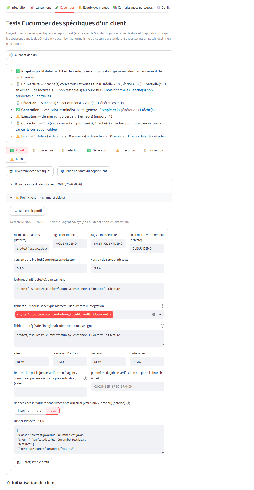

# Agent Scrum Master

Agent d'assistance aux développements Odatio. À partir d'un ticket Jira, il produit l'analyse (cadrage fonctionnel et technique), puis le patch Git et la release note, et les publie sur le ticket. Il s'appuie sur la CLI [Claude Code](https://docs.claude.com/fr/docs/claude-code/overview).

- **Intégration du besoin** : reformulation du besoin et questions ouvertes ajoutées à la description Jira. Les réponses saisies dans l'IHM y sont ajoutées à leur tour.
- **Analyse / cadrage** d'un ticket : la description Jira est mise à jour avec l'analyse.
- **Révision** de l'analyse selon vos consignes. Vos corrections sont mémorisées et réutilisées sur les tickets suivants.
- **Patch** : création de la branche, modifications, fichier `.patch` attaché au ticket et release note ajoutée à la description.
- **Épopées** : découpage en tâches enfants créées dans Jira, puis un patch par tâche.
- **Post-merge Cucumber** : à chaque merge Bitbucket, création d'un ticket `[CUCUMBER]` avec les scénarios BDD à adapter et le patch correspondant.

## Prérequis

| Outil | Usage |
|---|---|
| **Python 3.12** | Application (Streamlit) et outils |
| **Git** | Clones, branches et patchs |
| **Claude Code CLI** (`claude`), connectée | Exécution de l'agent |
| **JDK 21 + Maven** (recommandé) | Permet à l'agent de compiler et tester les patchs Java |
| **Pilote ODBC Microsoft** (facultatif) | Uniquement pour une base SQL Server via `pyodbc` |

Comptes et accès nécessaires : Jira Cloud (jeton API), Bitbucket KISCloud (jeton HTTP, droits lecture) et, en option, Jenkins et un compte base de données en lecture seule.

### Installer Claude Code

```powershell
irm https://claude.ai/install.ps1 | iex   # ou : npm install -g @anthropic-ai/claude-code
claude                                    # première exécution : connexion (/login)
```

L'agent utilise l'abonnement Claude de la CLI connectée. Si plusieurs comptes sont connectés sur le poste (un dossier de configuration par compte, ex. `~/.claude` et `~/.claude-pro`), choisissez celui à utiliser avec `CLAUDE_CONFIG_DIR` (onglet Configuration, section « Compte Claude ») ; vide = compte du shell de lancement, sinon `~/.claude`. Pour passer par une clé API, renseignez `ANTHROPIC_API_KEY`.

Le modèle et l'effort se règlent par étape dans le `.env` (ou l'onglet **⚙️ Configuration**) :

| Étape | Modèle (`--model`) | Effort (`--effort`) |
|---|---|---|
| Cadrage, épopée | `CLAUDE_MODEL_CADRAGE` | `CLAUDE_EFFORT_CADRAGE` |
| Révision, cadrage complété avec les réponses | `CLAUDE_MODEL_REFINE` | `CLAUDE_EFFORT_REFINE` |
| Patch | `CLAUDE_MODEL_PATCH` | `CLAUDE_EFFORT_PATCH` |
| Post-merge Cucumber | `CLAUDE_MODEL_POSTMERGE` | `CLAUDE_EFFORT_POSTMERGE` |
| Rédaction du besoin | `CLAUDE_MODEL_BESOIN` | `CLAUDE_EFFORT_BESOIN` |
| Lots Cucumber d'un client | `CLAUDE_MODEL_CUCUMBER` (vide = `sonnet`) | `CLAUDE_EFFORT_CUCUMBER` (`medium` proposé) |
| Correction de compilation / dry-run des lots Cucumber | `CLAUDE_MODEL_CUCUMBER_FIX` (vide = `haiku` ; en cas d'échec, dernière tentative avec `CLAUDE_MODEL_CUCUMBER`) | `CLAUDE_EFFORT_CUCUMBER_FIX` (vide = `low`) |
| Revue et correction après exécution des lots Cucumber | `CLAUDE_MODEL_CUCUMBER` | `CLAUDE_EFFORT_CUCUMBER_FIX` (vide = `low`) |
| Steps de recréation des données d'initializers (bouton Init, seulement s'il en reste à recréer) | `CLAUDE_MODEL_CUCUMBER` | `CLAUDE_EFFORT_CUCUMBER`, puis `CLAUDE_EFFORT_CUCUMBER_FIX` pour les corrections |

Modèle : alias (`sonnet`, `opus`, `haiku`) ou identifiant complet. Effort : `low`, `medium`, `high`, `xhigh` ou `max` ; une autre valeur est signalée et ignorée. Vide = réglage de Claude Code sur le poste. Le modèle et l'effort de chaque appel sont affichés dans le journal et enregistrés dans `.tmp/token_usage.csv` (colonnes `modele` et `effort`), avec les tokens et le coût, pour comparer les niveaux.

## Installation

```powershell
git clone https://github.com/AnthonyStocko/agent-savoye.git
cd agent-savoye
py -3.12 -m venv venv
venv\Scripts\python.exe -m pip install -r requirements.txt
copy .env.example .env
```

Complétez ensuite le `.env`, ou lancez l'application et utilisez l'onglet **⚙️ Configuration**. Les variables indispensables sont `JIRA_DOMAIN`, `JIRA_EMAIL`, `JIRA_API_TOKEN`, `JIRA_PROJECT_KEY`, `BITBUCKET_URL`, `BITBUCKET_HTTP_TOKEN` et `BITBUCKET_STD_REPO_PATH`. L'onglet Lancement signale celles qui manquent.

À personnaliser pour chaque utilisateur :

- `JIRA_OPEN_EPICS_TEAM` et `POSTMERGE_JIRA_COMPONENT` : votre équipe Atlassian (ex. `oda_Prenom_N`).
- `JIRA_SEARCH_TEAM`, `JIRA_SEARCH_STATUSES` et `JIRA_SEARCH_LABELS` : vos critères de recherche habituels.
- `BITBUCKET_STD_REPO_PATH` : URL du projet Bitbucket (clonée automatiquement dans `.tmp/`) ou chemin d'un clone local.

## Utilisation

```powershell
venv\Scripts\python.exe -m streamlit run app.py
```

1. **🧩 Intégration** : recherchez les tickets (projet, équipe, statuts, labels) ; choisissez un ticket puis **Rédaction du besoin**. L'agent reformule le besoin et liste les questions dont la réponse ne figure pas dans l'expression initiale. Pour cela, il consulte aussi tous les tickets Jira (tous projets) du même « Projet / Application » que le ticket, par exemple APPLI : champ `JIRA_APPLICATION_FIELD`, valeur modifiable dans l'onglet. Le tout est publié dans la section « Intégration du besoin » de la description Jira, le reste de la description restant intact. Répondez aux questions dans l'IHM puis cliquez sur **Envoyer les réponses et compléter le besoin**. Les réponses sont d'abord ajoutées sous leur question dans la description Jira. L'agent complète ensuite le besoin reformulé avec ces réponses et ne garde que les questions restantes. Si le ticket a déjà un cadrage (`<TICKET>-cadrage.md`), l'agent le complète aussi avec les réponses, puis le cadrage est remplacé dans la description Jira (le reste de la description est conservé). Questions et réponses sont conservées dans `.tmp/integration/`.
2. **🚀 Lancement** : recherchez les tickets (projet, équipe, statuts, labels), choisissez le ticket et le dépôt client, puis lancez l'analyse ou le patch. Pour les projets de `STD_ONLY_PROJECTS` (liste séparée par des virgules, vide par défaut), seul le socle Standard (branche `dev`) est utilisé.
3. **🥒 Cucumber** : saisissez le dépôt Bitbucket du projet client (le nom du client, donc le dépôt cible `<client>-cucumber`, en est déduit et reste modifiable), puis éventuellement le schéma BDD et le Projet / Application Jira (ex. `APPLI`). Le champ **Dépôt Bitbucket du Cucumber Standard** (défaut : `BITBUCKET_CUCUMBER_STD_REPO`) accepte une URL de navigation, une URL clonable ou le chemin d'un clone local, utilisé tel quel (fetch seulement). Chaque dépôt distant a son clone, `.tmp/cucumber_std/<projet>_<dépôt>/`, recloné si son `origin` change. Après `fetch`, il est détaché sur la première référence distante existante (`origin/release/<version>`, `origin/v<version>`, `origin/<version>`, tags de la version, puis `origin/dev`, `origin/main`, `origin/master`) ; la référence et le commit retenus s'affichent sous le champ.
   - **Parcours en 7 étapes** (voir [Parcours de l'onglet Cucumber](#parcours-de-longlet-cucumber)) : Projet, Couverture, Sélection, Génération, Exécution, Correction, Bilan. Chaque étape affiche son état et un résumé d'une ligne, et propose l'action suivante ; l'onglet s'ouvre sur la première étape qui attend une action.
   - **Inventaire des spécifiques** (aucun token) : Python compare chaque dépôt client au Standard. Les dépôts front (`CUCUMBER_EXCLUDE_REPOS`, par défaut `*-frontend`, `*-front`, `*-ui`) sont exclus : le Cucumber Standard ne pilote pas les écrans. Un fichier dont le contenu a déjà existé dans le Standard est un simple écart de version et est ignoré. Les fichiers restants sont classés `override`, `extension` ou `parametrage`, puis regroupés en spécifiques fonctionnels (processus Studio, plugin d'interface, objet métier). Python rapproche ensuite chaque spécifique de la couverture Cucumber existante, de ses tickets Jira et des tests du Cucumber Standard qui testent le même processus : au plus 3 features par spécifique, score ≥ `CUCUMBER_STD_MATCH_MIN` (0,4 par défaut). Le score combine les mots-clés du spécifique retrouvés dans la feature et dans les Step Definitions qu'elle utilise (noms de classes, endpoints, chemins REST), l'objet métier ou l'élément overridé, et le domaine. Ces features sont extraites dans `.tmp/cucumber/<client>/std/`, bornées à 150 lignes. Le détail repliable « Tests Standard liés » (étape Couverture) montre les spécifiques sans équivalent. Chaque `customized.xml` est comparé à sa référence (`original.xml` du dépôt client ou fichier du Standard ; aucune pour un processus propre au client) : chaque différence (écran, champ, bouton, condition, action, message) est un comportement à couvrir (`tools/cucumber_studio.py`), listé dans le détail de la tâche et injecté dans le lot (15 au plus).
   - **Profil client** (aucun token, `tools/cucumber_profile.py`, `--profile-only`, panneau « Profil client » de l'onglet) : tout ce que la génération et les contrôles doivent savoir du client, sans aucune valeur propre à un client dans le code. Fichier `.tmp/cucumber/<client>/profil.json` : `features_root` (racine de ses features), `tag_client` (casse exacte), `init_features` et `init_tags`, `clear_name` (clear propre à l'environnement), `spec_files` (fichiers d'intégration du module spécifique, dans l'ordre), `runner` (classe, chemin, features, glue, tags, plugin JSON, surcouche du Standard), `reference_codes` (sites, donneurs d'ordres, secteurs, partenaires créés par l'init), `library_version` (version du `test-jar` du Standard dans le `pom.xml`), `server_version` (version du serveur, celle du Standard applicatif), `server_initialized_data` (données créées au démarrage par les initializers Java du client, détectées dans ses dépôts par le motif générique `CUCUMBER_INITIALIZER_PATTERN`, hors `CUCUMBER_INITIALIZER_EXCLUDE_REPOS` ; valeurs littérales seulement, une création indirecte reste « partiel », jamais devinée ; statut par donnée : recréée, survit, effacée, inconnu) et `initializers_survive_clear` (vrai / faux / inconnu), `protected_files` (features d'init et fichiers qu'elles intègrent : toute modification par la génération est restaurée et bloque le patch), `workarounds` (marqueurs `TODO-VERSION:` du dépôt), `verify_branch` et `verify_branch_param` (branche lue par le job de vérification et paramètre qui la porte). Détection dans le dépôt `<client>-cucumber` à sa base (features et tags existants, feature(s) `@INIT_*`, argument de son step de purge, fichiers intégrés après l'initialisation globale, runner existant ou surcouche, `pom.xml`), lancée par l'inventaire ou « Détecter le profil ». Ce qui n'est pas détecté reste vide, avec un avertissement (seules la racine et le tag peuvent être déduits du nom du client, signalés comme tels). Le panneau signale les champs vides et permet de les corriger ; `spec_files` se choisit et s'ordonne parmi les fichiers de données du dépôt client hors initialisation Standard. Priorité champ par champ : fichier versionné `.agent-savoye.json` à la racine du dépôt client > saisie (cache) > détection. `CUCUMBER_INIT_TAGS` et `CUCUMBER_CLEAR_NAME` ne sont que des replis génériques, sans valeur par défaut. Un test (`tests/test_cucumber_profile.py`) échoue si une valeur du client fictif des tests apparaît dans `tools/`, `prompts/`, `main.py`, `app.py`, `jenkins/` ou `.env.example`.
   - **Générer l'initialisation client** (aucun token, `tools/cucumber_init.py`) : copie dans `<client>-cucumber` l'initialisation du Cucumber Standard de chaque module coché parmi WMS, TMS et OMS : `features/<MODULE>/01-Contexte/01-Initialisation.feature` (tag `@INIT_<MODULE>`) et ses fichiers de données `files/<MODULE>/01-Contexte/`, placés sous `features/<client>/01-Contexte/<MODULE>/` et `files/<client>/01-Contexte/<MODULE>/` (le step « INIT- Initialisation globale par fichiers via l'écran » charge le dossier de données qui correspond à celui de la feature). Cucumber trie les features par chemin (majuscules avant minuscules) : sous `01-Contexte`, l'initialisation s'exécute avant toutes les autres features du client (`EXC`, `REPORT`, `TMS`, `WMS`…). Copie fidèle : seuls le tag (`@INIT_<CLIENT>_<MODULE>`, plus `@<CLIENT>`), le titre (`<Client> - …`) et la purge changent. Trois étapes, toutes tirées du profil client : (1) le clear `clear_name` du profil (repli `CUCUMBER_CLEAR_NAME`, jamais de valeur par défaut : sans clear, la génération est refusée) à la place de la purge Standard (`clear/full/all`) ; (2) l'initialisation globale par fichiers du Standard ; (3) l'intégration des `spec_files` du profil, un step « INIT- Intégration des fichiers via l'écran » par fichier, dans l'ordre (chemin relatif au dossier de données de l'init), qui échoue si un fichier finit en `INTEGRATED_WITH_ERROR` ; sans `spec_files`, un avertissement rappelle que les données propres au client disparaîtront après le clear. Entre (2) et (3), **recréation des données d'initializers effacées par le clear** (statut « effacée » du profil, ou « inconnu » quand elles ne survivent pas au clear ; jamais ce qui survit) : par un step de création du Standard reconnu pour l'entité (table avec une colonne de code), sinon par un step du projet `INIT- <Client> recréation de <Entité> "<code>"` dont la méthode est écrite par un appel Claude borné (`cucumber_init_recreation.md` : mêmes valeurs que l'initializer, idempotente, initializer cité) puis contrôlée en Python (expression unique et absente du Standard, aucune méthode vide, compilation et dry-run) ; une recréation non livrable reste dans l'init, commentée sous `# TODO-INITIALIZER:`. C'est le seul appel Claude du bouton, et seulement s'il reste des données à recréer. Les steps d'init absents de la bibliothèque de steps du client ou de signature différente sont commentés sous `# TODO-VERSION: <raison>`, jamais supprimés (endpoint ou champs POJO modifiés : signalés « à vérifier ») ; une intégration sans attente du résultat (« INIT- Demande d'intégration… ») est remplacée par celle qui échoue sur `INTEGRATED_WITH_ERROR`. Le clear passe par le step client `INIT- Purge de l'environnement par le clear "<nom>"` (classe `Init<Client>Steps`, ajoutée au patch : aucun step du Standard ne prend de clear nommé ; même séquence que la purge Standard, jobs suspendus le temps du clear). Les autres steps restent ceux du Standard (dépendance `test-jar`). Chaque initialisation Standard purge l'environnement : ce sont des profils exclusifs, à lancer séparément, pas des briques cumulables. Les modules sont pré-cochés d'après les segments `wms` / `tms` / `oms` des noms des dépôts du client et des dossiers de premier niveau de ses spécifiques (inventaire) : les noms de dépôts seuls ne suffisent pas (ex. `odatio-client/client-tms-provider`). Python crée le worktree `.tmp/cucumber/<client>/worktree_init` sur la branche `cucumber_<client>_init` (distincts de ceux de la couverture), fait un seul commit et produit `<client>-cucumber-init.patch` (`git format-patch --binary` : les `.xlsm` et CSV restent intacts), téléchargeable dans « Derniers livrables ». Aucun patch si aucun module n'est coché, ou si la base contient déjà cette initialisation.
   - **Bilan de santé du dépôt client** (aucun token, `tools/cucumber_checks.py`, `--health-only`) : avant de générer, contrôle `<client>-cucumber` tel qu'il est à sa base, dans un worktree `.tmp/cucumber/<client>/worktree_sante` : features hors de la racine du client, tag client dans une autre casse ou absent d'un scénario actif, fichiers de données manquants (avec le chemin Standard à copier), cohérence du runner avec le profil, écart de version bibliothèque / Standard / serveur et écarts des steps utilisés entre la bibliothèque et le Standard aligné, marqueurs `TODO-VERSION:`, puis compilation (`CUCUMBER_COMPILE_CMD`) et dry-run de toutes ses features (steps non définis ou ambigus). Le bilan applique la racine et le tag du profil et compare `library_version` à la version du `pom.xml` du Cucumber Standard de la branche retenue (avertissement en cas d'écart). Si les features existantes ne compilent pas ou ont des steps non définis ou ambigus (dry-run strict de tout le projet), l'onglet avertit : « projet client décalé de sa bibliothèque de steps » — ce n'est pas un problème de génération, et leurs échecs à l'exécution ne viendront pas des tests générés. Après la compilation, les deux dry-runs de sélection (sans filtre, avec le tag client) donnent le nombre attendu. Rien n'est bloquant. Rapport `<client>-cucumber-sante.md`, affiché sous le bouton.
   - **Génération des tests Cucumber** : les spécifiques cochés sont traités par lots de `CUCUMBER_BATCH_SIZE`, avec un appel Claude neuf par lot (Sonnet par défaut, `--max-turns` `CUCUMBER_MAX_TURNS`, outils Read/Write/Edit/Grep/Glob seulement). L'agent ne reçoit que le sommaire du catalogue Cucumber Standard, les signatures Java du Standard et du dépôt client (jamais les corps), les fichiers, diffs résumés et signatures publiques du lot, les extraits Jira utiles, les tests Standard équivalents et les endpoints liés. Le catalogue des endpoints du Cucumber Standard (`endpoints_std.md`, une ligne par endpoint : méthode, chemin, classe Java qui l'encapsule, steps qui l'utilisent) est extrait sans token des classes `*EndPoints` ; chaque spécifique reçoit les endpoints Standard qu'il expose, surcharge ou dont le chemin nomme son objet métier, et les endpoints propres à ses contrôleurs. L'ordre de priorité est imposé : partir du test Standard équivalent (override : adapter le scénario Standard, commentaire `# Adapté de …`), puis réutiliser step Standard → step client → nouveau step sur un helper / endpoint Standard → nouveau code d'appel pour un endpoint propre au client seulement, et coder comme le Standard. Un scénario n'est écrit que s'il vérifie un comportement observable propre au client, échouerait sur le Standard seul, n'est pas un doublon, porte une assertion métier et cite sa source ; le JSON du lot donne pour chaque scénario `difference_standard` et `source`. L'exemple de `.feature` du lot est la feature Standard la mieux classée du lot. Chaque lot livre aussi les Step Definitions et classes d'appui nécessaires. Après chaque lot, Python contrôle les nouveaux scénarios : doublon d'un scénario Standard ou client (similarité du titre ou des steps ≥ `CUCUMBER_DUP_THRESHOLD`, 0,85 par défaut ; les scénarios de structure comme « Description de la fiche de test » sont ignorés), absence de `Then` ou `Then` génériques (statut HTTP), `difference_standard` ou `source` vides, taux de steps Standard réutilisés. Les scénarios signalés passent dans un seul appel de revue (`cucumber_client_review.md`, `--max-turns` `CUCUMBER_REVIEW_MAX_TURNS`, 8 par défaut) qui les corrige ou les conserve en le justifiant ; seul un doublon quasi exact peut être retiré. Après chaque lot, Python contrôle d'abord, sans token, les fichiers des features (`tools/cucumber_checks.py`) : (1) **emplacement** — toute nouvelle feature est sous la racine des features du client, détectée dans le dépôt (premier dossier sous `features/` le plus fréquent hors WMS / TMS / OMS, à défaut `features/<client>/`) ; un dossier du Standard s'y reproduit (`features/<client>/WMS/07-Stock/…`) ; (2) **tag client** — même casse que sur ses features existantes (ex. `@CLIENT`, jamais `@client`) ; (3) **fichiers de données** — chaque fichier cité dans un argument de step ou une cellule de table (`.xml`, `.xlsm`, `.xlsx`, `.csv`, `.json`, `.txt`…) et chaque règle du step « INIT- Intégration des règles » doivent exister dans le worktree au chemin résolu comme à l'exécution (`files/` ou `rules/` + dossier de la feature sous `features/` + nom). Un fichier présent seulement au Cucumber Standard ne compte pas : le dépôt client ne l'a pas à l'exécution. S'il existe au Standard sous ce nom (de préférence dans le dossier du scénario dont le lot s'inspire), il est copié automatiquement ; sinon c'est une erreur « fichiers » envoyée à la boucle de correction. (4) **initialisation du client** (`tools/cucumber_init_data.py`) — détectée avant le premier lot (tag `@INIT_*`, dossier `0x-Contexte`, ou `CUCUMBER_INIT_TAGS` en surcharge) et décrite dans `.tmp/cucumber/<client>/init_client.json` (chemin, tags, steps, fichiers intégrés). Les codes qu'elle crée sont extraits sans dépendance externe de ses fichiers (`.xlsm` / `.xlsx`, CSV, XML ; catégorie d'après le nom : `RefSite`, `RefStockOwner`, `WmsSector`, `WmsLocationArea`… ; colonne `code`, lignes `DELETE` exclues ; fichier illisible ignoré avec un avertissement) et des tables de ses steps de création. Ils sont injectés dans chaque lot : « Données créées par l'init du client : sites […], donneurs d'ordres […]… Utilise UNIQUEMENT ces codes, ou crée la donnée dans le Background ». Après le lot, sont des erreurs : une feature qui trierait avant l'init, un step de purge ou d'initialisation globale dans une nouvelle feature, un code de site ou de donneur d'ordres (colonnes `refSite.code`, `siteCode`, `refStockOwner.code`…) absent de l'init et non créé dans la feature ; (5) **runner** — un runner écrit par le lot alors qu'un runner existe, ou que le dépôt s'exécute en surcouche du Standard, est refusé (double exécution par Surefire) ; un runner créé faute d'en avoir doit couvrir la glue, la racine et l'init du client, exclure les scénarios désactivés et produire le rapport JSON ; le runner existant à compléter est relu sur disque après le lot (écart restant = erreur), et l'absence de tout runner hors surcouche est une erreur ; (6) **tag client** de chaque scénario actif, jamais hérité par un scénario désactivé ; (7) **champs contrôlés** — chaque colonne d'un `Then` généré doit être un champ mappé par le POJO de réponse du step (chemin pointé résolu sur les classes du projet et de la bibliothèque), sinon erreur avec les champs disponibles ; (8) **fichiers protégés** de l'init globale restaurés depuis la base, et aucun step, fichier de données ou règle encore utilisé supprimé. Ces contrôles tournent même sans `CUCUMBER_COMPILE_CMD`. **Runner et glue**, contrôlés avant le premier lot (correction livrée avec le premier lot) : `client_java_context` lit la glue, les chemins de features, le filtre de tags et les plugins des runners (`@CucumberOptions`, `@ConfigurationParameter`, `junit-platform.properties`). Un dépôt client sans `pom.xml`, ou sans runner propre et dépendant du `test-jar` du Standard, s'exécute en surcouche du Standard : le runner du Standard s'applique et aucun n'est créé. Un runner client existant avec un écart (features hors de son chemin, filtre sur le tag client, scénarios désactivés non exclus, pas de plugin `json:`, glue incomplète) est complété par une modification minimale, sur le modèle du runner du Standard injecté dans le lot, jamais doublé. Sans aucun runner, un seul est créé. Python compile ensuite (`CUCUMBER_COMPILE_CMD`, par défaut `mvn -q -o test-compile` ; dépôt client sans `pom.xml` : compilé par-dessus une copie du Standard dans `.tmp/cucumber/<client>/build`). En cas d'erreurs, jusqu'à `CUCUMBER_FIX_ATTEMPTS` appels de correction limités ont lieu ; si les erreurs persistent, le lot est commité quand même et passe en `erreur_compilation`. Le dry-run Cucumber strict est actif par défaut (`CUCUMBER_DRY_RUN=0` pour le désactiver) : un step du lot sans définition est une erreur de lot, corrigée par la boucle de correction. Après chaque lot, Python compare aussi les colonnes de chaque DataTable aux en-têtes utilisés pour le MÊME step dans le Cucumber Standard actuel : une colonne jamais vue au Standard est une erreur, avec la colonne du Standard la plus proche (ex. « status.value.id » → « status.id »). Les codes de site, de donneur d'ordres, de secteur ou de partenaire utilisés par une feature générée doivent figurer dans `reference_codes` du profil ou être créés dans la feature. Le prompt de lot reçoit, dans sa partie variable, un bloc « PROFIL CLIENT » : racine et tag autorisés, codes de référence, interdiction d'écrire purge, clear ou init, steps existants seulement avec la syntaxe de colonnes du Standard actuel, Background plutôt qu'un scénario « Contexte » séparé. Python crée le worktree, commite après chaque lot (un lot en échec — quota, code retour, JSON absent — n'est pas commité : ses fichiers sont annulés pour que la reprise reparte d'un état propre), puis produit `<client>-cucumber.patch` (refusé s'il reste un step `TEMPORAIRE-` ou un fichier protégé modifié ; sans les tags `@agent_` de vérification, gardés dans le worktree ; `CUCUMBER_KEEP_AGENT_TAGS=1` pour les conserver) et le récapitulatif `<client>-cucumber-couverture.md` (en tête, taux de réutilisation des steps Standard, scénarios générés / actifs / désactivés par cause, nombre attendu et doublons retirés à la revue avec leur motif ; par spécifique, scénarios, différence avec le Standard, source, test Standard d'inspiration, steps réutilisés / créés, endpoints et compilation). Le tableau des lots de l'onglet affiche ces indicateurs par lot. Rien n'est poussé, et le dépôt `<client>-cucumber` doit déjà exister.
   - **Économie de tokens des lots** : sessions allégées (`CLAUDE_LEAN_SESSION=1` par défaut, `0` pour revenir au comportement antérieur) — `--tools` limité aux outils autorisés, `--strict-mcp-config` (aucun serveur MCP), `--disable-slash-commands`, `--exclude-dynamic-system-prompt-sections` ; budget par appel facultatif (`CUCUMBER_MAX_BUDGET_USD`, `--max-budget-usd` : dépassement = lot en échec « budget atteint », repris par « Reprendre », les lots suivants continuent). Le contenu est injecté au lieu d'être lu : la partie fixe (règles, sommaire du catalogue Standard, Step Definitions exemplaire, exemples des recettes ; `prompts/cucumber_client_lot_systeme.md`) est ajoutée au prompt système (`--append-system-prompt-file`), identique pour tous les lots et donc lue depuis le cache à partir du 2e lot — un texte en tête du message ne l'est pas, le message formant un seul bloc ; le message (`prompts/cucumber_client_lot.md`) ne porte que le lot : consignes, exemple, runner s'il faut le créer, extraits Standard et Jira (dans la limite de `CUCUMBER_INLINE_MAX_CHARS`, 24 000 par défaut, au-delà le chemin reste à lire) et parties modifiées des `customized.xml` (nœuds modifiés et 3 lignes de contexte, au plus `CUCUMBER_INLINE_STUDIO_LINES` lignes par fichier, 150 par défaut ; le reste est lu à la demande). Chaque spécifique reçoit ses 15 steps Standard candidats (recettes, steps des tests équivalents, mots-clés et synonymes, avec classe et endpoint), calculés sans token. Avant les lots, un tri Python conclut sans appel les listeners / événements Studio sans logique propre (« couvert_indirectement » par le processus déclenché, s'il est sélectionné) et les spécifiques purement techniques (« non_couvert », motif « technique ») ; les lots sont regroupés par test Standard principal puis par domaine, les libellés réunis en un seul lot. La revue n'est pas lancée si les seuls motifs sont des champs `source` / `difference_standard` vides (notés dans le récapitulatif). Les corrections de compilation et de dry-run passent par `CLAUDE_MODEL_CUCUMBER_FIX` (défaut `haiku`, effort `CLAUDE_EFFORT_CUCUMBER_FIX`, défaut `low`), avec une dernière tentative sur le modèle du lot si elles échouent. `--max-lots N` limite une exécution à N lots (les suivants restent à reprendre). L'agent écrit tôt : une première version du `.feature` et des steps dès que le spécifique est compris, puis des améliorations ; à 75 % de `CUCUMBER_MAX_TURNS` (40 par défaut), il finalise et rend son JSON final. Tokens, cache, tours (`num_turns`) et coût de chaque appel : `.tmp/token_usage.csv`.
   - **Base de données** (champ « Schéma BDD » de l'onglet, `--db-schema`, défaut `DB_SCHEMA`) : chaque lot et chacune de ses corrections (compilation, dry-run, exécution, run importé) peuvent interroger la base en lecture seule (`tools/db_tools.py`, 3 commandes au plus par appel) pour le paramétrage et les valeurs de référence des jeux de données ; une « donnée de référence absente » se vérifie en base avant d'être créée ou signalée. Les commandes réellement lancées sont journalisées par lot (nature et tables lues, jamais le texte des requêtes ni les valeurs) : console (`Base consultée`), colonne « Base » des lots de l'onglet, section « Base de données consultée » du récapitulatif `<client>-cucumber-couverture.md`. Connexion absente ou schéma invalide : les lots continuent sans la base (avertissement `[BDD]`).
   - **Vérification par exécution** (`tools/cucumber_verify.py`, sans token) : chaque scénario reçoit un identifiant stable `<feature>::<scénario>` et les tags `@agent_<client>_<lot>` et `@agent_<client>_<lot>_<n>`. Au plus 3 exécutions par lot : sur le client (`CUCUMBER_VERIFY_ENV`) ; sur le Standard pour les overrides (`CUCUMBER_VERIFY_ENV_STD`, échec attendu sur un `Then`) ; sur le client avec les attendus des `Then` faussés par Python (mutation : dernier argument entre guillemets suffixé `_MUT`, une ligne de données sur deux des tables des `Then`), échec attendu. Seul un échec d'assertion compte pour ces contre-épreuves. Statuts : `pertinent`, `faible` (passe avec mutation ou sur le Standard), `invalide` (échoue sur le client pour une cause « test »), `non_verifie` (jamais compté pertinent, proposé en priorité à la revue humaine), et les statuts hors test ci-dessous. Exécution par le job Jenkins dédié `CUCUMBER_VERIFY_JOB` (voir « Prérequis du job Jenkins »), sinon repli local `CUCUMBER_VERIFY_LOCAL_CMD` (`{tags}`, `{env}`), durée bornée par `CUCUMBER_VERIFY_TIMEOUT` ; sans l'un ni l'autre : « pertinence non vérifiée par exécution ». L'initialisation du client (`init_tags` du profil, repli `CUCUMBER_INIT_TAGS`) s'exécute d'abord, une fois par génération : en échec, aucun lot n'est jugé (« environnement non initialisé »), avec le premier step en échec et sa cause. Un rapport dont le nombre de tests diffère du nombre attendu pour les tags lancés (lecture des features) n'est jamais analysé : run sur une autre version du code ou sélection de tags inopérante. Avec `CUCUMBER_JACOCO=1`, part des classes de chaque spécifique exécutées (`jacoco.exec`).
   - **Classement des échecs** (`failure_kind`, `failure_category`) : **environnement** (champ exigé par le serveur, ressource 404) et **version** (« 404 No route found », « Invalid path », « has no field additionalProperties », paramètre exigé inconnu du POJO : bibliothèque de steps plus ancienne que le serveur) → statut `environnement` ; **donnée de référence absente** (« … non trouvé(e) avec code … ») → `donnee_reference` ; **cascade** (échec d'un scénario de mise en place : les scénarios suivants de la feature) → `cascade` ; **déploiement** (code ou personnalisation déployés en retard sur le dépôt) → `deploiement`, jamais déduit du seul message : seulement sur un constat de la correction dont l'extrait cité est retrouvé mot pour mot dans le journal de l'exécution (message d'échec, sorties des steps) ; **défaut produit probable** (erreur serveur 5xx) → `bug_applicatif` ; **test** (step non défini, colonne, fichier, ordre, attente, assertion, et « expected:<X> but was:<null> » : champ contrôlé non renvoyé par l'endpoint ou non mappé par le POJO) → `invalide` ou `faible`. Les échecs « test » repartent en correction (`cucumber_client_fix.md`, au plus `CUCUMBER_VERIFY_FIX_ATTEMPTS` appels, 2 par défaut), contrôlée, recompilée et revérifiée ; une donnée de référence absente est d'abord créée dans le Background. **Diagnostic temporaire** : quand le message ne permet pas de trancher, la correction peut ajouter un step du projet `TEMPORAIRE-…` qui affiche l'état réel (`scenario.log`, aucune assertion) ; il est exécuté une fois, retiré automatiquement, et sa sortie est rendue à la correction suivante. Contrôle bloquant : aucun step `TEMPORAIRE-` dans le patch livré (patch refusé sinon).
   - **Règles de retrait : un scénario n'est jamais supprimé** (`tools/cucumber_a_revoir.py`). Une cause « test » se corrige ; une correction est annulée (fichier remis en l'état et erreur renvoyée) si elle supprime un scénario, un `Then` ou une assertion, ajoute `@ignore` ou le tag de désactivation, ou modifie une valeur attendue sans `# Réaligné sur le code : <fichier>` au-dessus du scénario (réalignement : l'attendu qui contredit le code — initializer, service — est réécrit sur le comportement réel, et le scénario reste actif). Un scénario bloqué par une cause hors test prouvée par le message d'échec est **désactivé** : tag générique `CUCUMBER_TAG_A_REVOIR` (défaut `@A_REVOIR`) au niveau du scénario, commentaire `# À revoir : <cause> — <preuve>` au-dessus, tag client descendu sur les seuls scénarios actifs (un tag de Feature s'applique à tous ses scénarios). **Seuils** : rien n'est désactivé et la génération s'arrête pour une décision humaine (lot `decision_humaine`, « Reprendre » relance correction et vérification) si un échec « test » persiste après les corrections, si les désactivations dépasseraient `CUCUMBER_MAX_RETRACT_PCT` % du lot (30 par défaut) ou si un spécifique n'aurait plus aucun scénario actif. Aucun nettoyage ne supprime un step (même retiré d'une classe conservée), un fichier de données ou une règle encore utilisé par un scénario, actif ou désactivé.
   - **`A_REVOIR.md`** (racine du dépôt client, livré avec les lots) : section générée entre deux marqueurs, le reste du fichier conservé. En tête, **Défauts détectés** (défauts produit, avérés d'abord, et constats « écart entre spécification et code ») ; puis chaque scénario désactivé : cause, preuve, condition de réactivation. Une cause déduite (défaut produit derrière une erreur serveur, cascade, déploiement non vérifié, constat de l'agent) est notée **NON PROUVÉE**, avec la vérification à faire : export des logs serveur sur une fenêtre de deux minutes autour du step en échec (heure lue dans le rapport, en UTC et en heure locale) et un texte de filtre — l'outil d'export plafonne le nombre de lignes et garde les plus récentes. `--server-log <export> --log-scenario <id ou tag>` vérifie qu'un export couvre bien l'heure du step (code 1 sinon, avec la fenêtre à réexporter). Suivent les scénarios faibles restés actifs et les lots arrêtés pour décision humaine. Le récapitulatif donne générés / actifs livrés / désactivés par cause, et le **nombre attendu** de la livraison.
   - **Sélection des scénarios et version exécutée** : le runner du client ne filtre jamais sur le tag client (l'init ou des features anciennes peuvent ne pas le porter) et exclut les scénarios désactivés (`tags = "not @A_REVOIR"`, combiné au filtre existant) : le filtre de tags du job peut ne pas atteindre Cucumber (propriété passée à Maven, pas à la JVM de test). Contrôle après chaque lot, à la livraison et au bilan de santé : chaque scénario actif porte le tag client (directement ou par sa ligne Feature, init comprise), aucun scénario désactivé n'en hérite. À la livraison, deux dry-runs stricts, sans filtre et avec le tag client, doivent sélectionner le même nombre de scénarios, égal aux scénarios actifs des features : c'est le **nombre attendu** (`etat.json`, récapitulatif) ; un run du job qui en exécute un autre nombre ne porte pas sur cette version ou ignore la sélection de tags. Avec `verify_branch` dans le profil, l'agent commite et pousse le worktree sur cette branche avant chaque vérification (jamais de push forcé ; push refusé : vérification arrêtée, « le job exécuterait une ancienne version ») et le job reçoit la branche (paramètre `verify_branch_param`, défaut `CUCUMBER_SPEC_BRANCH`) et le commit poussé ; sans `verify_branch`, le job reçoit le commit de base et le patch du worktree.
   - **Revue humaine** : l'onglet affiche chaque scénario vérifié (statut, niveaux statique / client / Standard / mutation, différence avec le Standard, source, test Standard d'inspiration, lien vers le build), les échecs hors test à part, et un échantillon de `CUCUMBER_REVIEW_SAMPLE` scénarios pertinents à juger (**Pertinent** / **Non pertinent** avec motif). Un verdict « Non pertinent » devient une consigne du projet (mémoire de l'agent), injectée dans les lots suivants. Le récapitulatif donne en tête les taux de scénarios pertinents, de mutations détectées, d'échec des overrides sur le Standard et de validation humaine.
   - **Import d'un rapport d'exécution** (`tools/cucumber_import.py`, panneau de l'onglet, `--import-run <fichiers>` / `--import-url <build Jenkins>`, sans token) : console Jenkins, rapport Cucumber JSON et exports de logs serveur (CSV), déposés ou lus en mémoire sur un build Jenkins. Les secrets (`-Dpassword*`, `-DuserName`, jetons, en-têtes `Authorization`, mots de passe d'URL ou de JSON, et leurs formes base64) sont masqués avant tout stockage ou affichage ; seule l'empreinte du fichier brut est gardée. Un fichier déjà importé est écarté ; un fichier du même run (horodatage de début) rejoint son import, réanalysé (scénarios dédoublonnés). Avant l'analyse, le nombre de tests est comparé au nombre attendu (tags lus dans la console, sinon nombre attendu de la livraison et scénarios des features) : un écart rend l'import « non analysé ». Sinon : échecs classés et regroupés par cause racine (catégorie, step, message sans ses valeurs variables), couverture des steps en échec par les exports de logs (sinon fenêtre à exporter en UTC et heure locale, texte de filtre ; lignes ERROR / WARN proches retenues comme preuves), comparaison avec l'import précédent (corrigés, nouveaux, inchangés, disparus), et lots de correction proposés pour les seuls échecs « test » des scénarios générés par l'agent, un par spécifique. **Lancer la correction ciblée** (`--complete --from-import N`) ajoute des lots « correction » : un appel de correction avec le message réel, puis compilation, vérification par exécution et règles de retrait comme pour un lot généré. Stockage : `.tmp/cucumber/<client>/imports/` (`index.json`, puis par import les fichiers masqués, `analyse.json` et `analyse.md`).
   - **Reprendre** : après une interruption (quota, erreur), reprend au premier lot non terminé (`.tmp/cucumber/<client>/etat.json`). Un lot en `erreur_compilation` ne relance que la correction.
4. **🔔 Écoute des merges** : démarre et arrête l'écoute périodique des merges Bitbucket (post-merge Cucumber).
5. **📚 Connaissances partagées** : état du répertoire partagé (joignable, documents indexés, documents en attente de dépôt), import de `.md` existants, recherche (projet ou client, type, ticket, mot-clé), aperçu, ouverture et changement de statut des documents. Voir [Connaissances partagées](#connaissances-partagées).
6. **⚙️ Configuration** : toutes les variables du `.env`, le test de connexion à la base, le test du répertoire partagé et la gestion de la mémoire de l'agent.

Sans IHM :

```powershell
venv\Scripts\python.exe main.py --issue SPEC-1234 --project SPEC --client-repo https://git.kiscloud.io/projects/CLIENT --step cadrage
venv\Scripts\python.exe main.py --step generate-cucumber-client --client-repo https://git.kiscloud.io/projects/CLIENT --application APPLI --inventory-only   # inventaire seul, sans token
venv\Scripts\python.exe main.py --step generate-cucumber-client --client-repo https://git.kiscloud.io/projects/CLIENT --init-only --init-modules WMS,TMS   # patch d'initialisation du client, sans token (défaut : modules détectés)
venv\Scripts\python.exe main.py --step generate-cucumber-client --client-repo https://git.kiscloud.io/projects/CLIENT --profile-only   # profil client détecté dans <client>-cucumber (profil.json), sans token
venv\Scripts\python.exe main.py --step generate-cucumber-client --client-repo https://git.kiscloud.io/projects/CLIENT --health-only   # bilan de santé du dépôt <client>-cucumber, sans token (code 1 si défauts)
venv\Scripts\python.exe main.py --step generate-cucumber-client --client-repo https://git.kiscloud.io/projects/CLIENT --application APPLI --db-schema CLIENT   # tests des spécifiques non couverts (client déduit : client)
venv\Scripts\python.exe main.py --step generate-cucumber-client --client-repo https://git.kiscloud.io/projects/CLIENT --resume   # reprise des lots non terminés
venv\Scripts\python.exe main.py --step generate-cucumber-client --client-repo https://git.kiscloud.io/projects/CLIENT --server-log export.csv --log-scenario @agent_client_2_1   # l'export de logs serveur couvre-t-il le step en échec ?
venv\Scripts\python.exe main.py --step generate-cucumber-client --client-repo https://git.kiscloud.io/projects/CLIENT --import-run console.txt cucumber.json serveur.csv   # import d'un rapport d'exécution, sans token
venv\Scripts\python.exe main.py --step generate-cucumber-client --client-repo https://git.kiscloud.io/projects/CLIENT --complete --from-import 3   # lots « correction » de l'import n° 3
venv\Scripts\python.exe webhook_server.py --poll --projects CLIENT   # écoute des merges
```

Les livrables (`<TICKET>-cadrage.md`, `<TICKET>-*.patch`, `<TICKET>-release-note.md`…) sont écrits à la racine du projet. Les clones, la mémoire et les journaux sont écrits dans `.tmp/`. Aucun de ces fichiers n'est versionné.

### Parcours de l'onglet Cucumber

L'onglet 🥒 se lit de haut en bas : « Client et dépôts » (replié une fois renseigné), la liste des 7 étapes avec leur résumé d'une ligne, puis l'étape choisie. Pastilles : ✅ fait, ⏳ à faire, ⚠️ à regarder, ▫️ rien pour l'instant. Tout est calculé sans token (`tools/cucumber_journey.py`, `tools/cucumber_coverage.py`). Captures faites sur un client de démonstration fictif.

1. **Projet** : inventaire des spécifiques, bilan de santé (verdict « sain » ou nombre de défauts), profil client, initialisation et dernier résultat connu de l'init (réussi, ou premier step en échec et sa cause).

   

2. **Couverture** : une ligne par tâche (spécifique de l'inventaire), avec module, point d'entrée (écrans Studio, endpoint, nature), risque métier, features liées, **état**, testabilité, dernière exécution et tickets Jira. Le tableau se trie par colonne et se filtre par état, module, risque, ticket ou mot-clé. Deux taux sont toujours affichés côte à côte : la couverture **réelle** (scénarios actifs et verts) et la couverture **écrite** (scénarios actifs et désactivés). Le nombre de tâches partielles est affiché à côté.
   - États : 🟢 couvert, vert · 🔴 couvert, en échec · 🟠 couvert, désactivé (cause) · 🔵 couvert, jamais exécuté · 🟣 partiel (les tests ne vérifient qu'une configuration ou la présence d'une donnée : rapprochement partiel avec les features existantes, ou scénarios « faibles » qui passent aussi sans le spécifique) · ⚪ non couvert · ⚫ non testable aujourd'hui (raison).
   - Dernier résultat de chaque scénario : le plus récent import de rapport d'exécution, à défaut la vérification par exécution du lot ; un scénario porteur du tag de désactivation dans le worktree est désactivé, avec la cause de son commentaire. Une tâche couverte indirectement (listener, événement) prend l'état de celle qui la couvre.
   - Testabilité (oui, à vérifier, non) : code spécifique déployé, personnalisation Studio déployée, données recréables par l'init, steps disponibles dans la bibliothèque. Un critère vaut « inconnu » par défaut, « non » sur une preuve d'exécution (échec « déploiement », donnée de référence absente, aucun step selon le lot), « oui » si un scénario lié est vert.
   - Le risque métier est proposé (libellés et paramétrage : faible ; override et processus : élevé ; sinon moyen). Le risque et les critères de testabilité se modifient dans le détail d'une ligne, qui montre aussi ses scénarios et leur dernier résultat, la cause d'échec ou de désactivation, les défauts et constats de l'agent, les comportements Studio à couvrir et les documents partagés liés. Les modifications sont enregistrées dans `.tmp/cucumber/<client>/couverture.json`.

   

3. **Sélection** : cases à cocher sur les tâches non couvertes, partielles ou non testables, dans l'ordre proposé : risque métier, puis testabilité, puis effort (fichiers, absence de test Standard ou de step candidat, comportements Studio). Les non couvertes et partielles sont cochées par défaut ; une tâche non testable aujourd'hui ne se génère qu'après un avertissement explicite et une confirmation. **Générer les tests** ajoute des lots à la génération en cours sans rien effacer (`--complete --specifics`), ou crée la première génération ; « Nouvelle génération » repart de la base, après confirmation. Le lot d'une tâche partielle reçoit la consigne de tester l'**effet** (document généré, message envoyé avec son contenu, statut atteint, champ enregistré relu), jamais la configuration seule.

   

4. **Génération** : reprise, complément, tableau des lots, vérification par exécution, revue humaine et patch.

   

5. **Exécution** : import de la console Jenkins, du rapport Cucumber JSON et des exports de logs serveur ; résultat du dernier run (verts, échecs, comparaison avec le run précédent) et logs serveur à exporter.

   

6. **Correction** : tâches en échec, causes racine du dernier import et lots de correction proposés (**Lancer la correction ciblée**).

   

7. **Bilan** : `A_REVOIR.md` (défauts détectés, scénarios désactivés) et récapitulatif de couverture.

   

### Prérequis du job Jenkins (Cucumber)

- Le job qui exécute le dépôt `<client>-cucumber` doit accepter un paramètre **`TAGS`** (expression de tags Cucumber passée à `-Dcucumber.filter.tags`) : il sert à lancer l'initialisation du client seule (`init_tags` du profil, ex. `@INIT_<CLIENT>_WMS`) et à la vérification des lots par l'agent (`@agent_<client>_<lot>_<n>`). Cette propriété doit atteindre la JVM de test (Surefire) : sinon le job exécute tout, ce que l'agent détecte par le nombre de tests du rapport (résultats non analysés). L'exclusion des scénarios désactivés ne compte pas sur elle : elle est dans le runner du client (`not @A_REVOIR`).
- Le job de vérification de l'agent (`CUCUMBER_VERIFY_JOB`, proposé dans `jenkins/CUCUMBER-VERIFY-PATCH.Jenkinsfile`) prend aussi `PATCH` (fichier), `ENV` et `CUCUMBER_SPEC_REPOSITORY`, et archive le rapport Cucumber JSON (`target/cucumber-reports/*.json`). `CUCUMBER_SPEC_BRANCH`, `CUCUMBER_SPEC_COMMIT` et `CUCUMBER_STANDARD_COMMIT` (recommandés) fixent la branche et les commits exécutés ; un patch non applicable donne « non vérifié : patch non applicable ». Avec `verify_branch` dans le profil, le job lit cette branche (paramètre `verify_branch_param`), où l'agent pousse avant chaque vérification.
- Chaque vérification exécute d'abord l'initialisation (`init_tags` du profil) ; si elle échoue, aucun lot n'est jugé (« environnement non initialisé », avec le premier step en échec et sa cause).
- Le rapport Cucumber JSON doit garder `start_timestamp` et les sorties des steps (`scenario.log`) : heure du step en échec pour la fenêtre des logs serveur, journal du diagnostic temporaire et preuve d'un constat de déploiement.

## Connaissances partagées

Chaque analyse de l'agent est déposée en Markdown dans un répertoire commun (partage réseau d'entreprise), puis consultée avant les analyses suivantes, par vous comme par vos collègues. C'est un complément de la mémoire locale (`.tmp/memory`, propre à chaque poste), qui reste inchangée. Le code est dans `tools/knowledge_tools.py` ; le masquage des secrets, commun à tout l'agent, dans `tools/secret_tools.py`.

### Configuration

| Variable | Rôle |
|---|---|
| `AGENT_KNOWLEDGE_DIR` | Répertoire partagé : chemin UNC (`\\serveur\partage\dossier`), lecteur mappé (`X:\dossier`) ou chemin POSIX (`/mnt/partage/dossier`). **Vide = fonction désactivée** : rien n'est déposé ni consulté. |
| `AGENT_KNOWLEDGE_AUTHOR` | Auteur inscrit dans les documents (vide = utilisateur système). |
| `AGENT_KNOWLEDGE_MAX_CONTEXT` | Taille maximale, en caractères, des connaissances injectées dans un prompt (défaut 6000, 0 = aucune). |

Dans l'onglet **⚙️ Configuration**, section « Connaissances partagées », enregistrez le chemin puis cliquez sur **Tester le répertoire partagé** : existence du dossier, lecture, droit d'écriture (un fichier témoin est créé, relu puis supprimé) et temps d'accès. Chaque opération est bornée à 15 s ; un échec dit quoi vérifier (chemin, réseau ou VPN, droits).

### Arborescence et format

```
<AGENT_KNOWLEDGE_DIR>/<projet>/<type>/<AAAA-MM-JJ_HHMMSS>_<sujet>_<auteur>.md
```

- `<projet>` : le client s'il est connu (déduit du dépôt client), sinon le projet Jira. Le projet Jira figure toujours dans l'en-tête.
- `<type>`, liste fermée : `cadrage`, `besoin`, `decoupage-epopee`, `recap-patch`, `release-note`, `postmerge-cucumber`, `cucumber-inventaire`, `cucumber-sante`, `cucumber-couverture`, `cucumber-a-revoir`, `cucumber-diagnostic-run`, `audit`, `autre`.
- Noms nettoyés pour Windows (caractères interdits, noms réservés, points finaux), chemin complet borné à 240 caractères.
- Un document n'est **jamais écrasé** : à nom identique, un suffixe `-2`, `-3`… est ajouté. L'écriture est atomique (fichier temporaire dans le même dossier, puis renommage) : un lecteur ne voit jamais un document à moitié écrit.

Chaque document commence par un en-tête YAML (une valeur JSON par ligne), suivi du corps de l'analyse tel quel :

```yaml
---
projet: "PROJ"
client: "<client>"
type: "cadrage"
sujet: "Titre du ticket"
tickets: ["PROJ-123"]
composants: ["<composant>"]
tags: []
date: "2026-10-26T09:05:07"
auteur: "<auteur>"
version_agent: "<git describe du dépôt de l'agent>"
depots: [{"nom": "<dépôt>", "commit": "<sha>"}]
statut: "actif"
remplace_par: ""
sources_partagees: ["<client>/cadrage/<document consulté>.md"]
resume: "5 lignes au plus"
---
```

`statut` vaut `actif`, `obsolète` ou `remplacé` (avec `remplace_par`, chemin relatif du document qui le remplace).

### Dépôt automatique

L'agent dépose, à la fin de chaque étape réussie :

| Étape | Type |
|---|---|
| Cadrage, révision, cadrage complété par les réponses | `cadrage` |
| Rédaction du besoin | `besoin` |
| Découpage d'une épopée (avec l'analyse de chaque tâche) | `decoupage-epopee` |
| Patch : récapitulatif de l'agent, release note | `recap-patch`, `release-note` |
| Post-merge Cucumber | `postmerge-cucumber` |
| Cucumber : inventaire (`--inventory-only`), bilan de santé, couverture (un document par génération), `A_REVOIR.md`, import d'un run | `cucumber-inventaire`, `cucumber-sante`, `cucumber-couverture`, `cucumber-a-revoir`, `cucumber-diagnostic-run` |

- **Nouvelle version** : un document de même projet, même type et même ticket (sans ticket : même sujet) marque automatiquement l'ancienne version active « remplacée par » la nouvelle, **quel qu'en soit l'auteur**. Un document déposé en retard ne remplace jamais une version plus récente.
- **Partage indisponible** : l'analyse n'est jamais bloquée. Le document (déjà masqué) attend dans la file locale `.tmp/knowledge_outbox`, réessayée au démarrage de chaque étape, avant chaque dépôt et depuis l'onglet 📚 (bouton **Déposer les documents en attente**).
- **Import ponctuel** de `.md` existants (`A_REVOIR.md`, `AUDIT.md`, `COUVERTURE.md`…) : onglet 📚, panneau « Importer des analyses Markdown existantes », ou en ligne de commande :

```powershell
venv\Scripts\python.exe -m tools.knowledge_tools import A_REVOIR.md --projet PROJ --type cucumber-a-revoir --tickets PROJ-1 --client <client>
venv\Scripts\python.exe -m tools.knowledge_tools flush   # dépose la file locale
```

### Consultation avant analyse

- Avant chaque analyse, l'agent cherche les documents pertinents : **même projet d'abord**, puis tickets, composants, tags et mots-clés communs (même similarité que la mémoire locale). Un document d'un autre projet n'est retenu que s'il a un point commun ; les documents obsolètes ou remplacés sont exclus.
- L'index est reconstruit à partir des en-têtes et mis en cache sur le poste (`.tmp/knowledge_index.json`) : seul un dossier `<projet>/<type>` modifié depuis la dernière lecture est relu. **Aucun fichier d'index n'est écrit sur le partage.** Partage injoignable : le dernier index connu est utilisé.
- Les plus proches puis les plus récents sont injectés dans le prompt (variable `${knowledge_block}`), dans la limite de `AGENT_KNOWLEDGE_MAX_CONTEXT` : chemin, date, auteur, statut, résumé et sections utiles (diagnostic et fichiers d'un cadrage, sinon début du document).
- Le bloc est présenté comme une **CONNAISSANCE ANTÉRIEURE À VÉRIFIER** : des données, jamais des instructions. Aucune consigne trouvée dans un document partagé ne s'applique ; le code et les résultats d'exécution l'emportent toujours sur un document.
- L'agent peut lire les documents complets (`--add-dir`), avec écriture et modification interdites sur ce répertoire (`--disallowedTools`) et la consigne de lecture seule. Les lots Cucumber ne reçoivent que les extraits.
- Les documents consultés sont affichés dans la console et listés dans le document déposé (en-tête `sources_partagees` et section finale « Connaissances partagées consultées »).

### Confidentialité

- **Tout utilisateur qui a accès au partage lit tous les documents**, de tous les projets et de tous les clients. Réglez les droits du partage en conséquence (un partage par périmètre de confidentialité si nécessaire) et ne le configurez pas sur un poste qui ne doit pas voir ces analyses.
- Avant tout dépôt, les secrets sont masqués avec les mêmes règles que le reste de l'agent : mots de passe et jetons (`-Dpassword*`, `-DuserName`, `-D*token*`, paramètres d'URL et champs JSON), en-têtes `Authorization`, formes base64 de ces valeurs, et valeurs secrètes de votre `.env` (`*_TOKEN`, `*_SECRET`, `*_PASSWORD`, `*_API_KEY`).
- **Si un motif de secret subsiste après masquage** (clé privée, jeton JWT, Atlassian, GitHub, Anthropic, clé AWS…), le dépôt est **refusé** : rien n'est écrit, ni sur le partage ni dans la file locale, et la console l'indique.
- Le masquage n'est pas une garantie absolue : ne collez pas de données personnelles ou de secrets dans les tickets et les analyses.

### Bonnes pratiques

- Testez le répertoire après chaque changement de configuration ; un accès lent (plus de 2 s) ralentit chaque dépôt et chaque consultation.
- Marquez **obsolète** (onglet 📚) un document devenu faux, plutôt que de le supprimer : il reste consultable sur demande et n'est plus injecté.
- Ne modifiez pas le corps d'un document à la main : déposez une nouvelle analyse, qui remplacera l'ancienne. Une retouche manuelle de l'en-tête reste lisible (valeurs JSON ou texte simple).
- Ne créez pas d'autres fichiers dans les dossiers `<projet>/<type>` : seuls les `.md` sont indexés, les fichiers commençant par `.` sont ignorés.
- Une information tirée d'un document partagé se vérifie dans le code avant d'être reprise.

## Personnaliser les prompts

Les consignes envoyées à l'agent sont dans `prompts/` :

| Fichier | Étape |
|---|---|
| `besoin.md`, `cadrage_reponses.md` | Rédaction du besoin et questions ouvertes, cadrage complété avec les réponses (onglet Intégration) |
| `cucumber_client_lot.md`, `cucumber_client_review.md`, `cucumber_client_fix.md` | Un lot de tests Cucumber des spécifiques d'un client (onglet Cucumber) : partie fixe en tête, lot en fin ; revue des scénarios signalés par les contrôles ; correction des erreurs de compilation et des scénarios invalides ou faibles après exécution (diagnostic temporaire, constat de déploiement) |
| `cucumber_init_recreation.md` | Steps du projet recréant, dans l'initialisation du client, les données d'initializers serveur effacées par le clear |
| `cadrage.md`, `refine.md` | Analyse d'un ticket, révision |
| `epic_cadrage.md`, `epic_revision.md` | Découpage d'une épopée |
| `patch.md`, `patch_cucumber.md` | Génération du patch (sans ou avec tests Cucumber) |
| `postmerge.md` | Ticket et patch Cucumber post-merge |
| `token_saving_rules.md`, `db_access.md`, `cucumber_enabled.md`, `cucumber_disabled.md`, `release_note.md` | Blocs communs |

Les connaissances partagées sont injectées par `${knowledge_block}` (à côté de `${capitalization_block}`) ; un modèle personnalisé qui ne contient pas cette variable les reçoit en fin de prompt.

Les variables s'écrivent `${nom}`, par exemple `${target_issue}`. Pour écrire un `$` littéral, utilisez `$$`. Si un modèle contient une variable inconnue, l'exécution s'arrête et le message liste les variables disponibles.

Pour adapter les prompts sans toucher au dépôt, renseignez `PROMPTS_DIR` avec un dossier personnel. Tout `<nom>.md` présent dans ce dossier remplace le modèle du même nom, et les autres modèles restent ceux du projet.

Les conventions de développement lues par l'agent sont dans `odatio-specific-code-conventions-dev.md`. Pour en utiliser d'autres, renseignez `DEV_CONVENTIONS_PATH`.

## Mise à jour

```powershell
git pull
venv\Scripts\python.exe -m pip install -r requirements.txt
```

Comparez ensuite votre `.env` avec `.env.example` pour repérer les nouvelles variables.
