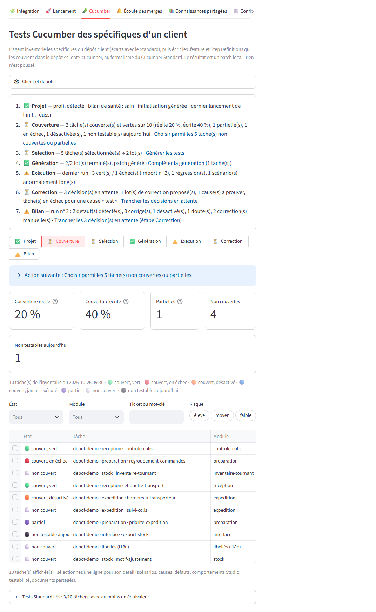
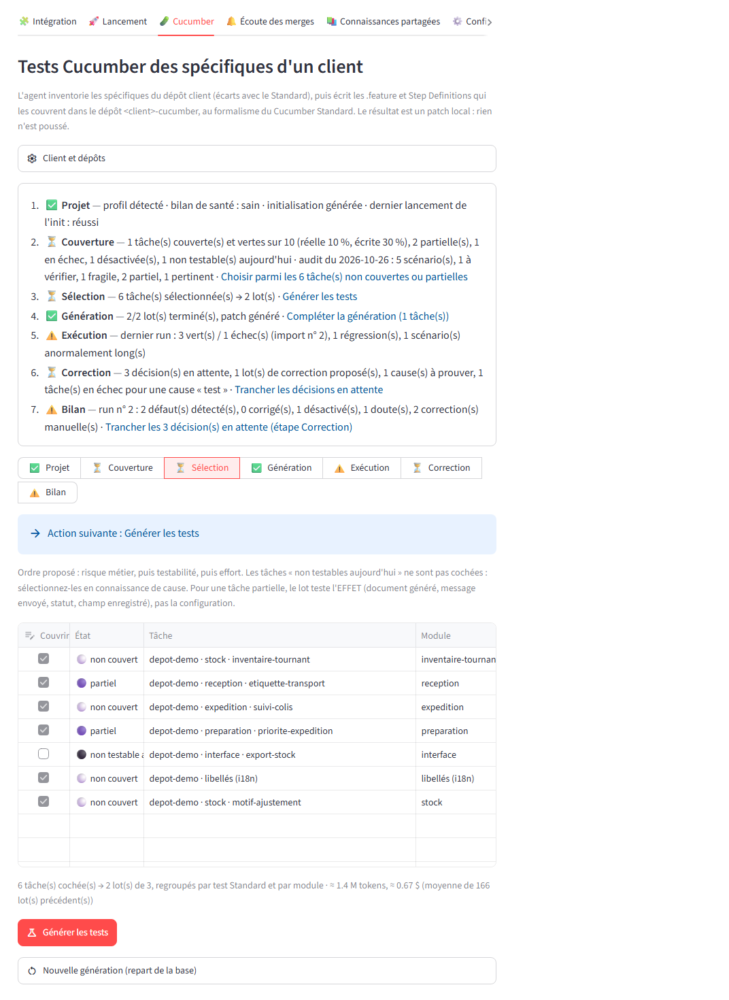
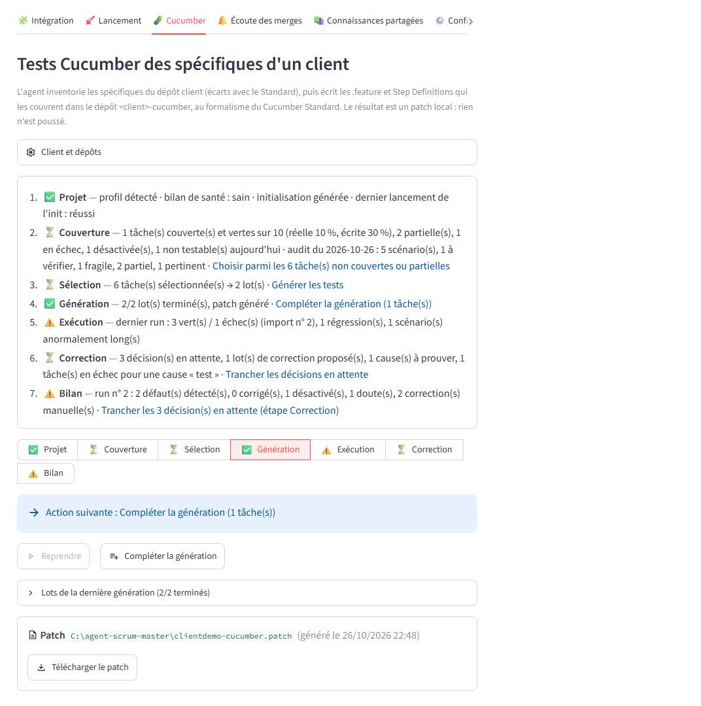
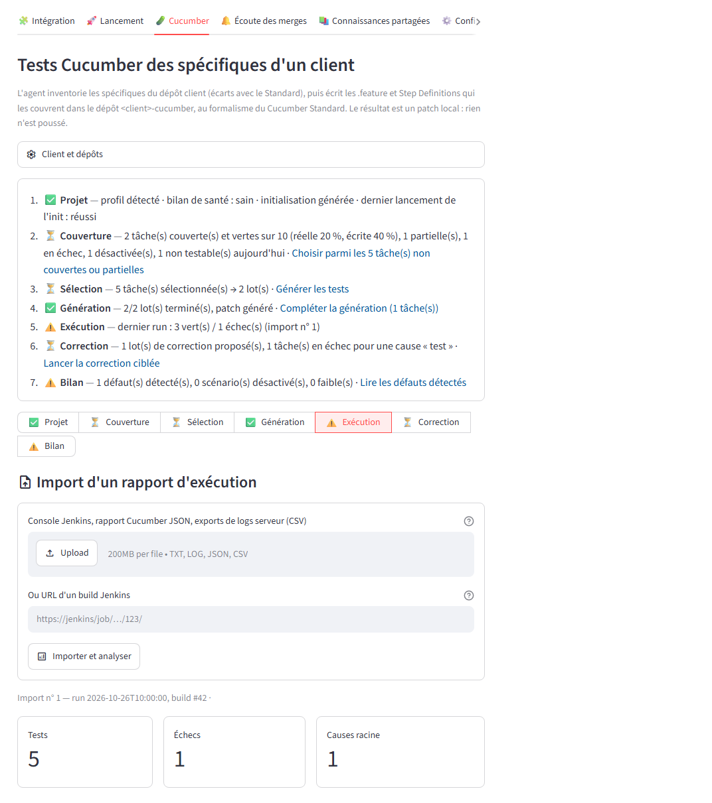
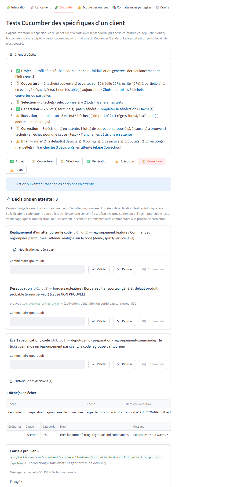
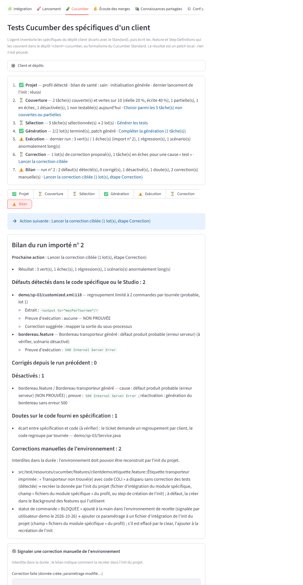

# Agent Scrum Master

Agent d'assistance aux développements Odatio. À partir d'un ticket Jira, il produit l'analyse (cadrage fonctionnel et technique), puis le patch Git et la release note, et les publie sur le ticket. Il s'appuie sur la CLI [Claude Code](https://docs.claude.com/fr/docs/claude-code/overview).

- **Intégration du besoin** : reformulation du besoin et questions ouvertes ajoutées à la description Jira. Les réponses saisies dans l'IHM y sont ajoutées à leur tour.
- **Analyse / cadrage** d'un ticket : la description Jira est mise à jour avec l'analyse.
- **Révision** de l'analyse selon vos consignes. Vos corrections sont mémorisées et réutilisées sur les tickets suivants.
- **Patch** : création de la branche, modifications, fichier `.patch` attaché au ticket et release note ajoutée à la description.
- **Épopées** : découpage en tâches enfants créées dans Jira, puis un patch par tâche.
- **Post-merge Cucumber** : à chaque merge Bitbucket, création d'un ticket `[CUCUMBER]` avec les scénarios BDD à adapter et le patch correspondant.

## Prérequis

| Outil | Usage |
|---|---|
| **Python 3.12** | Application (Streamlit) et outils |
| **Git** | Clones, branches et patchs |
| **Claude Code CLI** (`claude`), connectée | Exécution de l'agent |
| **JDK 21 + Maven** (recommandé) | Permet à l'agent de compiler et tester les patchs Java |
| **Pilote ODBC Microsoft** (facultatif) | Uniquement pour une base SQL Server via `pyodbc` |

Comptes et accès nécessaires : Jira Cloud (jeton API), Bitbucket KISCloud (jeton HTTP, droits lecture) et, en option, Jenkins et un compte base de données en lecture seule.

### Installer Claude Code

```powershell
irm https://claude.ai/install.ps1 | iex   # ou : npm install -g @anthropic-ai/claude-code
claude                                    # première exécution : connexion (/login)
```

L'agent utilise l'abonnement Claude de la CLI connectée. Si plusieurs comptes sont connectés sur le poste (un dossier de configuration par compte, ex. `~/.claude` et `~/.claude-pro`), choisissez celui à utiliser avec `CLAUDE_CONFIG_DIR` (onglet Configuration, section « Compte Claude ») ; vide = compte du shell de lancement, sinon `~/.claude`. Pour passer par une clé API, renseignez `ANTHROPIC_API_KEY`.

Le modèle et l'effort se règlent par étape dans le `.env` (ou l'onglet **⚙️ Configuration**) :

| Étape | Modèle (`--model`) | Effort (`--effort`) |
|---|---|---|
| Cadrage, épopée | `CLAUDE_MODEL_CADRAGE` | `CLAUDE_EFFORT_CADRAGE` |
| Révision, cadrage complété avec les réponses | `CLAUDE_MODEL_REFINE` | `CLAUDE_EFFORT_REFINE` |
| Patch | `CLAUDE_MODEL_PATCH` | `CLAUDE_EFFORT_PATCH` |
| Post-merge Cucumber | `CLAUDE_MODEL_POSTMERGE` | `CLAUDE_EFFORT_POSTMERGE` |
| Rédaction du besoin | `CLAUDE_MODEL_BESOIN` | `CLAUDE_EFFORT_BESOIN` |
| Lots Cucumber d'un client | `CLAUDE_MODEL_CUCUMBER` (vide = `sonnet`) | `CLAUDE_EFFORT_CUCUMBER` (`medium` proposé) |
| Correction de compilation / dry-run des lots Cucumber | `CLAUDE_MODEL_CUCUMBER_FIX` (vide = `haiku` ; en cas d'échec, dernière tentative avec `CLAUDE_MODEL_CUCUMBER`) | `CLAUDE_EFFORT_CUCUMBER_FIX` (vide = `low`) |
| Revue et correction après exécution des lots Cucumber | `CLAUDE_MODEL_CUCUMBER` | `CLAUDE_EFFORT_CUCUMBER_FIX` (vide = `low`) |
| Steps de recréation des données d'initializers (bouton Init, seulement s'il en reste à recréer) | `CLAUDE_MODEL_CUCUMBER` | `CLAUDE_EFFORT_CUCUMBER`, puis `CLAUDE_EFFORT_CUCUMBER_FIX` pour les corrections |

Modèle : alias (`sonnet`, `opus`, `haiku`) ou identifiant complet. Effort : `low`, `medium`, `high`, `xhigh` ou `max` ; une autre valeur est signalée et ignorée. Vide = réglage de Claude Code sur le poste. Le modèle et l'effort de chaque appel sont affichés dans le journal et enregistrés dans `.tmp/token_usage.csv` (colonnes `modele` et `effort`), avec les tokens et le coût, pour comparer les niveaux.

## Installation

```powershell
git clone https://github.com/AnthonyStocko/agent-savoye.git
cd agent-savoye
py -3.12 -m venv venv
venv\Scripts\python.exe -m pip install -r requirements.txt
copy .env.example .env
```

Complétez ensuite le `.env`, ou lancez l'application et utilisez l'onglet **⚙️ Configuration**. Les variables indispensables sont `JIRA_DOMAIN`, `JIRA_EMAIL`, `JIRA_API_TOKEN`, `JIRA_PROJECT_KEY`, `BITBUCKET_URL`, `BITBUCKET_HTTP_TOKEN` et `BITBUCKET_STD_REPO_PATH`. L'onglet Lancement signale celles qui manquent.

À personnaliser pour chaque utilisateur :

- `JIRA_OPEN_EPICS_TEAM` et `POSTMERGE_JIRA_COMPONENT` : votre équipe Atlassian (ex. `oda_Prenom_N`).
- `JIRA_SEARCH_TEAM`, `JIRA_SEARCH_STATUSES` et `JIRA_SEARCH_LABELS` : vos critères de recherche habituels.
- `BITBUCKET_STD_REPO_PATH` : URL du projet Bitbucket (clonée automatiquement dans `.tmp/`) ou chemin d'un clone local.

## Utilisation

```powershell
venv\Scripts\python.exe -m streamlit run app.py
```

1. **🧩 Intégration** : recherchez les tickets (projet, équipe, statuts, labels) ; choisissez un ticket puis **Rédaction du besoin**. L'agent reformule le besoin et liste les questions dont la réponse ne figure pas dans l'expression initiale. Pour cela, il consulte aussi tous les tickets Jira (tous projets) du même « Projet / Application » que le ticket, par exemple APPLI : champ `JIRA_APPLICATION_FIELD`, valeur modifiable dans l'onglet. Le tout est publié dans la section « Intégration du besoin » de la description Jira, le reste de la description restant intact. Répondez aux questions dans l'IHM puis cliquez sur **Envoyer les réponses et compléter le besoin**. Les réponses sont d'abord ajoutées sous leur question dans la description Jira. L'agent complète ensuite le besoin reformulé avec ces réponses et ne garde que les questions restantes. Si le ticket a déjà un cadrage (`<TICKET>-cadrage.md`), l'agent le complète aussi avec les réponses, puis le cadrage est remplacé dans la description Jira (le reste de la description est conservé). Questions et réponses sont conservées dans `.tmp/integration/`.
2. **🚀 Lancement** : recherchez les tickets (projet, équipe, statuts, labels), choisissez le ticket et le dépôt client, puis lancez l'analyse ou le patch. Pour les projets de `STD_ONLY_PROJECTS` (liste séparée par des virgules, vide par défaut), seul le socle Standard (branche `dev`) est utilisé.
3. **🥒 Cucumber** : choisissez le projet dans la liste des projets connus (réglages enregistrés dans `.tmp/cucumber/<client>/projet.json`), ou « Nouveau projet… » : saisissez alors le dépôt Bitbucket du projet client (le nom du client, donc le dépôt cible `<client>-cucumber`, en est déduit et reste modifiable), puis éventuellement le schéma BDD et le Projet / Application Jira (ex. `APPLI`). Le reste est détecté automatiquement (voir [Détection automatique](#détection-automatique-du-projet)). Le champ **Dépôt Bitbucket du Cucumber Standard** (défaut : `BITBUCKET_CUCUMBER_STD_REPO`) accepte une URL de navigation, une URL clonable ou le chemin d'un clone local, utilisé tel quel (fetch seulement). Chaque dépôt distant a son clone, `.tmp/cucumber_std/<projet>_<dépôt>/`, recloné si son `origin` change. Après `fetch`, il est détaché sur la première référence distante existante (`origin/release/<version>`, `origin/v<version>`, `origin/<version>`, tags de la version, puis `origin/dev`, `origin/main`, `origin/master`) ; la référence et le commit retenus s'affichent sous le champ.
   - **Vue d'ensemble** (voir [Parcours de l'onglet Cucumber](#parcours-de-longlet-cucumber)) : une ligne d'état du projet (« <Client> · init incomplète (3 éléments) · 12 tâches couvertes sur 67 · dernier run : 37 verts / 2 échecs »), les actions proposées (« Générer les tests », « Importer des logs Jenkins »), le profil client et le bilan de santé repliés, puis les étapes Couverture, Sélection, Génération, Exécution, Correction et Bilan, repliées tant qu'aucune n'est choisie. Chaque étape affiche son état et un résumé d'une ligne, et propose l'action suivante.
   - **Détection automatique du projet** (`tools/cucumber_detection.py`, `--detect-only`, aucun token, lecture seule) : voir [Détection automatique](#détection-automatique-du-projet). Elle remplace les boutons « Inventaire des spécifiques », « Détecter le profil » et la section « Initialisation du client ».
   - **Inventaire des spécifiques** (aucun token) : Python compare chaque dépôt client au Standard. Les dépôts front (`CUCUMBER_EXCLUDE_REPOS`, par défaut `*-frontend`, `*-front`, `*-ui`) sont exclus : le Cucumber Standard ne pilote pas les écrans. Un fichier dont le contenu a déjà existé dans le Standard est un simple écart de version et est ignoré. Les fichiers restants sont classés `override`, `extension` ou `parametrage`, puis regroupés en spécifiques fonctionnels (processus Studio, plugin d'interface, objet métier). Python rapproche ensuite chaque spécifique de la couverture Cucumber existante, de ses tickets Jira et des tests du Cucumber Standard qui testent le même processus : au plus 3 features par spécifique, score ≥ `CUCUMBER_STD_MATCH_MIN` (0,4 par défaut). Le score combine les mots-clés du spécifique retrouvés dans la feature et dans les Step Definitions qu'elle utilise (noms de classes, endpoints, chemins REST), l'objet métier ou l'élément overridé, et le domaine. Ces features sont extraites dans `.tmp/cucumber/<client>/std/`, bornées à 150 lignes. Le détail repliable « Tests Standard liés » (étape Couverture) montre les spécifiques sans équivalent. Chaque `customized.xml` est comparé à sa référence (`original.xml` du dépôt client ou fichier du Standard ; aucune pour un processus propre au client) : chaque différence (écran, champ, bouton, condition, action, message) est un comportement à couvrir (`tools/cucumber_studio.py`), listé dans le détail de la tâche et injecté dans le lot (15 au plus).
   - **Profil client** (aucun token, `tools/cucumber_profile.py`, `--profile-only`, panneau « Profil client » de l'onglet) : tout ce que la génération et les contrôles doivent savoir du client, sans aucune valeur propre à un client dans le code. Fichier `.tmp/cucumber/<client>/profil.json` : `features_root` (racine de ses features), `tag_client` (casse exacte), `init_features` et `init_tags`, `clear_name` (clear propre à l'environnement), `spec_files` (fichiers d'intégration du module spécifique, dans l'ordre), `runner` (classe, chemin, features, glue, tags, plugin JSON, surcouche du Standard), `reference_codes` (sites, donneurs d'ordres, secteurs, partenaires créés par l'init), `library_version` (version du `test-jar` du Standard dans le `pom.xml`), `server_version` (version du serveur, celle du Standard applicatif), `server_initialized_data` (données créées au démarrage par les initializers Java du client, détectées dans ses dépôts par le motif générique `CUCUMBER_INITIALIZER_PATTERN`, hors `CUCUMBER_INITIALIZER_EXCLUDE_REPOS` ; valeurs littérales seulement, une création indirecte reste « partiel », jamais devinée ; statut par donnée : recréée, survit, effacée, inconnu) et `initializers_survive_clear` (vrai / faux / inconnu), `protected_files` (features d'init et fichiers qu'elles intègrent : toute modification par la génération est restaurée et bloque le patch), `workarounds` (marqueurs `TODO-VERSION:` du dépôt), `verify_branch` et `verify_branch_param` (branche lue par le job de vérification et paramètre qui la porte). Détection dans le dépôt `<client>-cucumber` à sa base (features et tags existants, feature(s) `@INIT_*`, argument de son step de purge, fichiers intégrés après l'initialisation globale, runner existant ou surcouche, `pom.xml`), faite par la détection automatique du projet dans une copie de lecture du dépôt (`.tmp/cucumber/<client>/copie_profil`, clone local `--shared` : ni branche, ni worktree, ni index écrit dans le dépôt client). Ce qui n'est pas détecté reste vide, avec un avertissement (seules la racine et le tag peuvent être déduits du nom du client, signalés comme tels). Le panneau « Profil client » est un résumé en lecture seule, replié : projet, racine des features, tag client, init (absente / incomplète / complète, avec ses constats et leurs preuves), runner, versions. Un seul indicateur : 🟢 profil complet, 🟠 champs manquants (nombre et liste), 🔴 détection impossible (cause). Le lien « Corriger » ouvre l'édition des seuls champs manquants (et de ceux choisis comme faux) ; l'enregistrement relance la détection. `spec_files` se choisit et s'ordonne parmi les fichiers de données du dépôt client hors initialisation Standard. Priorité champ par champ : fichier versionné `.agent-savoye.json` à la racine du dépôt client > saisie (cache) > détection. `CUCUMBER_INIT_TAGS` et `CUCUMBER_CLEAR_NAME` ne sont que des replis génériques, sans valeur par défaut. Un test (`tests/test_cucumber_profile.py`) échoue si une valeur du client fictif des tests apparaît dans `tools/`, `prompts/`, `main.py`, `app.py`, `jenkins/` ou `.env.example`.
   - **Lot d'initialisation des données** (aucun token, `tools/cucumber_init.py`, `--init-only`) : proposé par la génération des tests selon l'état détecté de l'init (voir [Détection automatique](#détection-automatique-du-projet)), en premier lot, dans un patch séparé. **Init absente** : lot « Initialisation des données », décrit ci-dessous. **Init incomplète** : lot « Compléments d'initialisation », qui ne contient que les éléments manquants livrables (données d'initializers effacées par le clear et non recréées, contrôle des dépendances d'environnement, déclarations de champs personnalisés utilisés) dans une **nouvelle** feature `99-Complements-initialisation.feature`, à côté de la première feature d'init et taguée comme elle (suffixe `-2`, `-3`… si elle existe déjà) : jamais de réécriture de l'init existante, jamais de fichier protégé modifié (patch refusé sinon). Les constats non livrables (clear non conforme, steps `TODO-VERSION`, init en échec au dernier run) figurent dans le lot avec leur preuve, à traiter à la main. **Init complète** : rien n'est proposé. `--init-modules` force la copie de l'initialisation Standard des modules donnés. L'initialisation Standard copie dans `<client>-cucumber` l'initialisation du Cucumber Standard de chaque module du client parmi WMS, TMS et OMS : `features/<MODULE>/01-Contexte/01-Initialisation.feature` (tag `@INIT_<MODULE>`) et ses fichiers de données `files/<MODULE>/01-Contexte/`, placés sous `features/<client>/01-Contexte/<MODULE>/` et `files/<client>/01-Contexte/<MODULE>/` (le step « INIT- Initialisation globale par fichiers via l'écran » charge le dossier de données qui correspond à celui de la feature). Cucumber trie les features par chemin (majuscules avant minuscules) : sous `01-Contexte`, l'initialisation s'exécute avant toutes les autres features du client (`EXC`, `REPORT`, `TMS`, `WMS`…). Copie fidèle : seuls le tag (`@INIT_<CLIENT>_<MODULE>`, plus `@<CLIENT>`), le titre (`<Client> - …`) et la purge changent. Trois étapes, toutes tirées du profil client : (1) le clear `clear_name` du profil (repli `CUCUMBER_CLEAR_NAME`, jamais de valeur par défaut : sans clear, la génération est refusée) à la place de la purge Standard (`clear/full/all`) ; (2) l'initialisation globale par fichiers du Standard ; (3) l'intégration des `spec_files` du profil, un step « INIT- Intégration des fichiers via l'écran » par fichier, dans l'ordre (chemin relatif au dossier de données de l'init), qui échoue si un fichier finit en `INTEGRATED_WITH_ERROR` ; sans `spec_files`, un avertissement rappelle que les données propres au client disparaîtront après le clear. Entre (2) et (3), **recréation des données d'initializers effacées par le clear** (statut « effacée » du profil, ou « inconnu » quand elles ne survivent pas au clear ; jamais ce qui survit) : par un step de création du Standard reconnu pour l'entité (table avec une colonne de code), sinon par un step du projet `INIT- <Client> recréation de <Entité> "<code>"` dont la méthode est écrite par un appel Claude borné (`cucumber_init_recreation.md` : mêmes valeurs que l'initializer, idempotente, initializer cité) puis contrôlée en Python (expression unique et absente du Standard, aucune méthode vide, compilation et dry-run) ; une recréation non livrable reste dans l'init, commentée sous `# TODO-INITIALIZER:`. C'est le seul appel Claude du lot, avec l'écriture du step de contrôle de l'environnement, et seulement s'il reste des données à recréer ou des dépendances à contrôler. Les steps d'init absents de la bibliothèque de steps du client ou de signature différente sont commentés sous `# TODO-VERSION: <raison>`, jamais supprimés (endpoint ou champs POJO modifiés : signalés « à vérifier ») ; une intégration sans attente du résultat (« INIT- Demande d'intégration… ») est remplacée par celle qui échoue sur `INTEGRATED_WITH_ERROR`. Le clear passe par le step client `INIT- Purge de l'environnement par le clear "<nom>"` (classe `Init<Client>Steps`, ajoutée au patch : aucun step du Standard ne prend de clear nommé ; même séquence que la purge Standard, jobs suspendus le temps du clear). Les autres steps restent ceux du Standard (dépendance `test-jar`). Chaque initialisation Standard purge l'environnement : ce sont des profils exclusifs, à lancer séparément, pas des briques cumulables. Les modules sont détectés d'après les segments `wms` / `tms` / `oms` des noms des dépôts du client et des dossiers de premier niveau de ses spécifiques (inventaire) : les noms de dépôts seuls ne suffisent pas (ex. `odatio-client/client-tms-provider`). Python crée le worktree `.tmp/cucumber/<client>/worktree_init` sur la branche `cucumber_<client>_init` (distincts de ceux de la couverture), fait un seul commit et produit `<client>-cucumber-init.patch` (`git format-patch --binary` : les `.xlsm` et CSV restent intacts), téléchargeable dans les étapes Sélection et Génération. Aucun patch si aucun module n'est détecté, ou si la base contient déjà cette initialisation. **Contrôle de l'environnement** (step `INIT- <Client> contrôle de l'environnement`, lecture seule) : il n'échoue que sur une absence **prouvée** ; une dépendance qu'il ne peut pas confirmer est un avertissement dans le log du scénario (un `fail` sur une dépendance « non confirmée » est refusé en Python). Champ personnalisé sans endpoint de lecture de sa déclaration : contrôle indirect par les champs personnalisés d'un objet de l'entité existant ou créé par l'init ; si aucun contrôle n'est possible, la dépendance est déclarée « non vérifiable » par l'écriture des steps, retirée du scénario (et le scénario, voire la feature des compléments, s'il ne reste rien à contrôler) et signalée dans le rapport en avertissement non bloquant (« déclaration des champs personnalisés non vérifiable par l'API »).
   - **Bilan de santé du dépôt client** (aucun token, `tools/cucumber_checks.py`, `--health-only`) : avant de générer, contrôle `<client>-cucumber` tel qu'il est à sa base, dans un worktree `.tmp/cucumber/<client>/worktree_sante` : features hors de la racine du client, tag client dans une autre casse ou absent d'un scénario actif, fichiers de données manquants (avec le chemin Standard à copier), cohérence du runner avec le profil, écart de version bibliothèque / Standard / serveur et écarts des steps utilisés entre la bibliothèque et le Standard aligné, marqueurs `TODO-VERSION:`, puis compilation (`CUCUMBER_COMPILE_CMD`) et dry-run de toutes ses features (steps non définis ou ambigus). Le bilan applique la racine et le tag du profil et compare `library_version` à la version du `pom.xml` du Cucumber Standard de la branche retenue (avertissement en cas d'écart). Si les features existantes ne compilent pas ou ont des steps non définis ou ambigus (dry-run strict de tout le projet), l'onglet avertit : « projet client décalé de sa bibliothèque de steps » — ce n'est pas un problème de génération, et leurs échecs à l'exécution ne viendront pas des tests générés. Après la compilation, les deux dry-runs de sélection (sans filtre, avec le tag client) donnent le nombre attendu. Rien n'est bloquant. Lancé à la demande (« Lancer le bilan de santé », section repliée « Bilan de santé du dépôt client » de l'onglet : compilation et dry-run prennent plusieurs minutes, il n'est pas relancé automatiquement). Rapport `<client>-cucumber-sante.md`, affiché dans la section.
   - **Génération des tests Cucumber** : les spécifiques cochés sont traités par lots de `CUCUMBER_BATCH_SIZE`, avec un appel Claude neuf par lot (Sonnet par défaut, `--max-turns` `CUCUMBER_MAX_TURNS`, outils Read/Write/Edit/Grep/Glob seulement). L'agent ne reçoit que le sommaire du catalogue Cucumber Standard, les signatures Java du Standard et du dépôt client (jamais les corps), les fichiers, diffs résumés et signatures publiques du lot, les extraits Jira utiles, les tests Standard équivalents et les endpoints liés. Le catalogue des endpoints du Cucumber Standard (`endpoints_std.md`, une ligne par endpoint : méthode, chemin, classe Java qui l'encapsule, steps qui l'utilisent) est extrait sans token des classes `*EndPoints` ; chaque spécifique reçoit les endpoints Standard qu'il expose, surcharge ou dont le chemin nomme son objet métier, et les endpoints propres à ses contrôleurs. L'ordre de priorité est imposé : partir du test Standard équivalent (override : adapter le scénario Standard, commentaire `# Adapté de …`), puis réutiliser step Standard → step client → nouveau step sur un helper / endpoint Standard → nouveau code d'appel pour un endpoint propre au client seulement, et coder comme le Standard. Un scénario n'est écrit que s'il vérifie un comportement observable propre au client, échouerait sur le Standard seul, n'est pas un doublon, porte une assertion métier et cite sa source ; le JSON du lot donne pour chaque scénario `difference_standard` et `source`. L'exemple de `.feature` du lot est la feature Standard la mieux classée du lot. Chaque lot livre aussi les Step Definitions et classes d'appui nécessaires. Après chaque lot, Python contrôle les nouveaux scénarios : doublon d'un scénario Standard ou client (similarité du titre ou des steps ≥ `CUCUMBER_DUP_THRESHOLD`, 0,85 par défaut ; les scénarios de structure comme « Description de la fiche de test » sont ignorés), absence de `Then` ou `Then` génériques (statut HTTP), `difference_standard` ou `source` vides, taux de steps Standard réutilisés. Les scénarios signalés passent dans un seul appel de revue (`cucumber_client_review.md`, `--max-turns` `CUCUMBER_REVIEW_MAX_TURNS`, 8 par défaut) qui les corrige ou les conserve en le justifiant ; seul un doublon quasi exact peut être retiré. Après chaque lot, Python contrôle d'abord, sans token, les fichiers des features (`tools/cucumber_checks.py`) : (1) **emplacement** — toute nouvelle feature est sous la racine des features du client, détectée dans le dépôt (premier dossier sous `features/` le plus fréquent hors WMS / TMS / OMS, à défaut `features/<client>/`) ; un dossier du Standard s'y reproduit (`features/<client>/WMS/07-Stock/…`) ; (2) **tag client** — même casse que sur ses features existantes (ex. `@CLIENT`, jamais `@client`) ; (3) **fichiers de données** — chaque fichier cité dans un argument de step ou une cellule de table (`.xml`, `.xlsm`, `.xlsx`, `.csv`, `.json`, `.txt`…) et chaque règle du step « INIT- Intégration des règles » doivent exister dans le worktree au chemin résolu comme à l'exécution (`files/` ou `rules/` + dossier de la feature sous `features/` + nom). Un fichier présent seulement au Cucumber Standard ne compte pas : le dépôt client ne l'a pas à l'exécution. S'il existe au Standard sous ce nom (de préférence dans le dossier du scénario dont le lot s'inspire), il est copié automatiquement ; sinon c'est une erreur « fichiers » envoyée à la boucle de correction. (4) **initialisation du client** (`tools/cucumber_init_data.py`) — détectée avant le premier lot (tag `@INIT_*`, dossier `0x-Contexte`, ou `CUCUMBER_INIT_TAGS` en surcharge) et décrite dans `.tmp/cucumber/<client>/init_client.json` (chemin, tags, steps, fichiers intégrés). Les codes qu'elle crée sont extraits sans dépendance externe de ses fichiers (`.xlsm` / `.xlsx`, CSV, XML ; catégorie d'après le nom : `RefSite`, `RefStockOwner`, `WmsSector`, `WmsLocationArea`… ; colonne `code`, lignes `DELETE` exclues ; fichier illisible ignoré avec un avertissement) et des tables de ses steps de création. Ils sont injectés dans chaque lot : « Données créées par l'init du client : sites […], donneurs d'ordres […]… Utilise UNIQUEMENT ces codes, ou crée la donnée dans le Background ». Après le lot, sont des erreurs : une feature qui trierait avant l'init, un step de purge ou d'initialisation globale dans une nouvelle feature, un code de site ou de donneur d'ordres (colonnes `refSite.code`, `siteCode`, `refStockOwner.code`…) absent de l'init et non créé dans la feature ; (5) **runner** — un runner écrit par le lot alors qu'un runner existe, ou que le dépôt s'exécute en surcouche du Standard, est refusé (double exécution par Surefire) ; un runner créé faute d'en avoir doit couvrir la glue, la racine et l'init du client, exclure les scénarios désactivés et produire le rapport JSON ; le runner existant à compléter est relu sur disque après le lot (écart restant = erreur), et l'absence de tout runner hors surcouche est une erreur ; (6) **tag client** de chaque scénario actif, jamais hérité par un scénario désactivé ; (7) **champs contrôlés** — chaque colonne d'un `Then` généré doit être un champ mappé par le POJO de réponse du step (chemin pointé résolu sur les classes du projet et de la bibliothèque), sinon erreur avec les champs disponibles ; (8) **fichiers protégés** de l'init globale restaurés depuis la base, et aucun step, fichier de données ou règle encore utilisé supprimé. Ces contrôles tournent même sans `CUCUMBER_COMPILE_CMD`. **Runner et glue**, contrôlés avant le premier lot (correction livrée avec le premier lot) : `client_java_context` lit la glue, les chemins de features, le filtre de tags et les plugins des runners (`@CucumberOptions`, `@ConfigurationParameter`, `junit-platform.properties`). Un dépôt client sans `pom.xml`, ou sans runner propre et dépendant du `test-jar` du Standard, s'exécute en surcouche du Standard : le runner du Standard s'applique et aucun n'est créé. Un runner client existant avec un écart (features hors de son chemin, filtre sur le tag client, scénarios désactivés non exclus, pas de plugin `json:`, glue incomplète) est complété par une modification minimale, sur le modèle du runner du Standard injecté dans le lot, jamais doublé. Sans aucun runner, un seul est créé. Le contrôle fait avant le premier lot et la modification du runner livrée dans le patch (fichier, lignes ajoutées / retirées, raison) sont repris dans la section « Runner » du récapitulatif de couverture. Python compile ensuite (`CUCUMBER_COMPILE_CMD`, par défaut `mvn -q -o test-compile` ; dépôt client sans `pom.xml` : compilé par-dessus une copie du Standard dans `.tmp/cucumber/<client>/build`). En cas d'erreurs, jusqu'à `CUCUMBER_FIX_ATTEMPTS` appels de correction limités ont lieu ; si les erreurs persistent, le lot est commité quand même et passe en `erreur_compilation`. Le dry-run Cucumber strict est actif par défaut (`CUCUMBER_DRY_RUN=0` pour le désactiver) : un step du lot sans définition est une erreur de lot, corrigée par la boucle de correction. Après chaque lot, Python compare aussi les colonnes de chaque DataTable aux en-têtes utilisés pour le MÊME step dans le Cucumber Standard actuel : une colonne jamais vue au Standard est une erreur, avec la colonne du Standard la plus proche (ex. « status.value.id » → « status.id »). Les codes de site, de donneur d'ordres, de secteur ou de partenaire utilisés par une feature générée doivent figurer dans `reference_codes` du profil ou être créés dans la feature. Le prompt de lot reçoit, dans sa partie variable, un bloc « PROFIL CLIENT » : racine et tag autorisés, codes de référence, interdiction d'écrire purge, clear ou init, steps existants seulement avec la syntaxe de colonnes du Standard actuel, Background plutôt qu'un scénario « Contexte » séparé. Python crée le worktree, commite après chaque lot (un lot en échec — quota, code retour, JSON absent — n'est pas commité : ses fichiers sont annulés pour que la reprise reparte d'un état propre), puis produit `<client>-cucumber.patch` (refusé s'il reste un step `TEMPORAIRE-` ou un fichier protégé modifié ; sans les tags `@agent_` de vérification, gardés dans le worktree ; `CUCUMBER_KEEP_AGENT_TAGS=1` pour les conserver) et le récapitulatif `<client>-cucumber-couverture.md` (en tête, taux de réutilisation des steps Standard, scénarios générés / actifs / désactivés par cause, nombre attendu et doublons retirés à la revue avec leur motif ; par spécifique, scénarios, différence avec le Standard, source, test Standard d'inspiration, steps réutilisés / créés, endpoints et compilation). Le tableau des lots de l'onglet affiche ces indicateurs par lot. Rien n'est poussé, et le dépôt `<client>-cucumber` doit déjà exister.
   - **Enseignements des campagnes** (point 9) :
     - **Règles de génération** (prompt système des lots) : les données reprises du Standard respectent les règles du client actives sur l'environnement (chaque feature crée dans son Background des données conformes, sans modifier l'init globale ni affaiblir la règle) ; un champ personnalisé utilisé doit être déclaré sur l'entité et s'écrit par le mécanisme prévu à cet effet, identifié dans le Standard, jamais deviné ; tout step qui écrit une donnée la relit et échoue explicitement si elle n'est pas enregistrée ; une mise à jour par brouillon repart du brouillon complet lu et renvoie tous les attributs requis ; un processus interactif Studio suit l'enchaînement des écrans du customized.xml déployé, désigne un bouton par son identifiant ou son libellé selon le step, avec les libellés de la langue affichée, et chaque scénario vérifie un élément propre à la personnalisation.
     - **Longueur des codes** (`tools/cucumber_rules.py`, contrôle de lot sans token) : la longueur maximale du champ code de chaque entité est lue dans les modèles des dépôts serveur du Standard et du client (classes `@Entity` : `@Column(length = …)`, `@Size(max = …)`, `@Length(max = …)`, constantes résolues ; index mis en cache par commit dans `.tmp/cucumber/<client>/longueurs_codes.json`) ; chaque code créé par une feature (table d'un step de création, colonne `code`) est comparé à celle de son entité, 20 caractères par défaut seulement si le modèle n'est pas trouvé : un code trop long est une erreur de lot.
     - **Échecs connus** (`failure_kind`, piste de correction `failure_hint` jointe à chaque correction) : « Unable to find the custom field » (déclaration manquante : environnement, recréée par l'init), « La taille de la valeur … est trop grande » (longueur), « La propriété … est requise » (brouillon incomplet), liste de choix vide sur un champ obligatoire (paramétrage absent : environnement), ordre non lançable après le contrôle du client (données non conformes à une règle active), délai du canal WebSocket « form » (écran attendu différent de l'écran reçu : diagnostic d'écran au run suivant).
     - **Environnement reconstruit par l'init** (`tools/cucumber_environment.py`, lot d'initialisation des données) : à la fin de chaque feature d'initialisation globale, un scénario recrée les corrections manuelles de l'environnement signalées dans le bilan (une correction manuelle n'est jamais une solution durable), puis un scénario contrôle en LECTURE SEULE les dépendances des tests — déclarations de champs personnalisés, documents, valeurs d'énumération, paramétrages : champ « dépendances d'environnement » du profil client et champs personnalisés introuvables relevés dans les runs importés. Le contrôle accumule tout ce qui manque et échoue une seule fois avec la liste : un environnement incomplet produit un échec clair dans l'init. Les steps du projet sont écrits par un appel Claude borné (`cucumber_init_environnement.md`), contrôlés (expression unique absente du Standard, méthode non vide, aucune écriture dans le contrôle, compilation et dry-run) ; non livrables, les scénarios restent commentés sous `# TODO-ENVIRONNEMENT:`.
   - **Économie de tokens des lots** : sessions allégées (`CLAUDE_LEAN_SESSION=1` par défaut, `0` pour revenir au comportement antérieur) — `--tools` limité aux outils autorisés, `--strict-mcp-config` (aucun serveur MCP), `--disable-slash-commands`, `--exclude-dynamic-system-prompt-sections` ; budget par appel facultatif (`CUCUMBER_MAX_BUDGET_USD`, `--max-budget-usd` : dépassement = lot en échec « budget atteint », repris par « Reprendre », les lots suivants continuent). Le contenu est injecté au lieu d'être lu : la partie fixe (règles, sommaire du catalogue Standard, Step Definitions exemplaire, exemples des recettes ; `prompts/cucumber_client_lot_systeme.md`) est ajoutée au prompt système (`--append-system-prompt-file`), identique pour tous les lots et donc lue depuis le cache à partir du 2e lot — un texte en tête du message ne l'est pas, le message formant un seul bloc ; le message (`prompts/cucumber_client_lot.md`) ne porte que le lot : consignes, exemple, runner s'il faut le créer, extraits Standard et Jira (dans la limite de `CUCUMBER_INLINE_MAX_CHARS`, 24 000 par défaut, au-delà le chemin reste à lire) et parties modifiées des `customized.xml` (nœuds modifiés et 3 lignes de contexte, au plus `CUCUMBER_INLINE_STUDIO_LINES` lignes par fichier, 150 par défaut ; le reste est lu à la demande). Chaque spécifique reçoit ses 15 steps Standard candidats (recettes, steps des tests équivalents, mots-clés et synonymes, avec classe et endpoint), calculés sans token. Avant les lots (nouvelle génération comme complément), un tri Python conclut sans appel, par analyse du XML, les éléments Studio sans logique propre — déclaration d'événement ou de variables seulement, listener sans condition ni transformation (mappings `$event.*` seuls), sans action ni écran — « couverts par le processus qui les utilise » (`studio_dependencies`), quel que soit l'état de ce processus, ou « sans objet » si ce processus est du Standard ; aucun lot n'est lancé pour eux. Il conclut aussi les spécifiques purement techniques (« non_couvert », motif « technique ») ; les lots sont regroupés par test Standard principal puis par domaine, les libellés réunis en un seul lot. La revue n'est pas lancée si les seuls motifs sont des champs `source` / `difference_standard` vides (notés dans le récapitulatif). Les corrections de compilation et de dry-run passent par `CLAUDE_MODEL_CUCUMBER_FIX` (défaut `haiku`, effort `CLAUDE_EFFORT_CUCUMBER_FIX`, défaut `low`), avec une dernière tentative sur le modèle du lot si elles échouent. `--max-lots N` limite une exécution à N lots (les suivants restent à reprendre). L'agent écrit tôt : une première version du `.feature` et des steps dès que le spécifique est compris, puis des améliorations ; à 75 % de `CUCUMBER_MAX_TURNS` (40 par défaut), il finalise et rend son JSON final. Tokens, cache, tours (`num_turns`) et coût de chaque appel : `.tmp/token_usage.csv`.
   - **Base de données** (champ « Schéma BDD » de l'onglet, `--db-schema`, défaut `DB_SCHEMA`) : chaque lot et chacune de ses corrections (compilation, dry-run, exécution, run importé) peuvent interroger la base en lecture seule (`tools/db_tools.py`, 3 commandes au plus par appel) pour le paramétrage et les valeurs de référence des jeux de données ; une « donnée de référence absente » se vérifie en base avant d'être créée ou signalée. Les commandes réellement lancées sont journalisées par lot (nature et tables lues, jamais le texte des requêtes ni les valeurs) : console (`Base consultée`), colonne « Base » des lots de l'onglet, section « Base de données consultée » du récapitulatif `<client>-cucumber-couverture.md`. Connexion absente ou schéma invalide : les lots continuent sans la base (avertissement `[BDD]`).
   - **Vérification par exécution** (`tools/cucumber_verify.py`, sans token) : chaque scénario reçoit un identifiant stable `<feature>::<scénario>` et les tags `@agent_<client>_<lot>` et `@agent_<client>_<lot>_<n>`. Au plus 3 exécutions par lot : sur le client (`CUCUMBER_VERIFY_ENV`) ; sur le Standard pour les overrides (`CUCUMBER_VERIFY_ENV_STD`, échec attendu sur un `Then`) ; sur le client avec les attendus des `Then` faussés par Python (mutation : dernier argument entre guillemets suffixé `_MUT`, une ligne de données sur deux des tables des `Then`), échec attendu. Seul un échec d'assertion compte pour ces contre-épreuves. Statuts : `pertinent`, `faible` (passe avec mutation ou sur le Standard), `invalide` (échoue sur le client pour une cause « test »), `non_verifie` (jamais compté pertinent, proposé en priorité à la revue humaine), et les statuts hors test ci-dessous. Exécution par le job Jenkins dédié `CUCUMBER_VERIFY_JOB` (voir « Prérequis du job Jenkins »), sinon repli local `CUCUMBER_VERIFY_LOCAL_CMD` (`{tags}`, `{env}`), durée bornée par `CUCUMBER_VERIFY_TIMEOUT` ; sans l'un ni l'autre : « pertinence non vérifiée par exécution ». L'initialisation du client (`init_tags` du profil, repli `CUCUMBER_INIT_TAGS`) s'exécute d'abord, une fois par génération : en échec, aucun lot n'est jugé (« environnement non initialisé »), avec le premier step en échec et sa cause. Un rapport dont le nombre de tests diffère du nombre attendu pour les tags lancés (lecture des features) n'est jamais analysé : run sur une autre version du code ou sélection de tags inopérante. Avec `CUCUMBER_JACOCO=1`, part des classes de chaque spécifique exécutées (`jacoco.exec`).
   - **Classement des échecs** (`failure_kind`, `failure_category`) : **environnement** (champ exigé par le serveur, ressource 404) et **version** (« 404 No route found », « Invalid path », « has no field additionalProperties », paramètre exigé inconnu du POJO : bibliothèque de steps plus ancienne que le serveur) → statut `environnement` ; **donnée de référence absente** (« … non trouvé(e) avec code … ») → `donnee_reference` ; **cascade** (échec d'un scénario de mise en place : les scénarios suivants de la feature) → `cascade` ; **déploiement** (code ou personnalisation déployés en retard sur le dépôt) → `deploiement`, jamais déduit du seul message : seulement sur un constat de la correction dont l'extrait cité est retrouvé mot pour mot dans le journal de l'exécution (message d'échec, sorties des steps) ; **défaut produit probable** (erreur serveur 5xx) → `bug_applicatif` ; **test** (step non défini, colonne, fichier, ordre, attente, assertion, et « expected:<X> but was:<null> » : champ contrôlé non renvoyé par l'endpoint ou non mappé par le POJO) → `invalide` ou `faible`. Les échecs « test » repartent en correction (`cucumber_client_fix.md`, au plus `CUCUMBER_VERIFY_FIX_ATTEMPTS` appels, 2 par défaut), contrôlée, recompilée et revérifiée ; une donnée de référence absente est d'abord créée dans le Background. **Diagnostic temporaire** : quand le message ne permet pas de trancher, la correction peut ajouter un step du projet `TEMPORAIRE-…` qui affiche l'état réel (`scenario.log`, aucune assertion) ; il est exécuté une fois, retiré automatiquement, et sa sortie est rendue à la correction suivante. Contrôle bloquant : aucun step `TEMPORAIRE-` dans le patch livré (patch refusé sinon).
   - **Règles de retrait : un scénario n'est jamais supprimé** (`tools/cucumber_a_revoir.py`). Une cause « test » se corrige ; une correction est annulée (fichier remis en l'état et erreur renvoyée) si elle supprime un scénario, un `Then` ou une assertion, ajoute `@ignore` ou le tag de désactivation, ou modifie une valeur attendue sans `# Réaligné sur le code : <fichier>` au-dessus du scénario (réalignement : l'attendu qui contredit le code — initializer, service — est réécrit sur le comportement réel, et le scénario reste actif). Un scénario bloqué par une cause hors test prouvée par le message d'échec est **désactivé** : tag générique `CUCUMBER_TAG_A_REVOIR` (défaut `@A_REVOIR`) au niveau du scénario, commentaire `# À revoir : <cause> — <preuve>` au-dessus, tag client descendu sur les seuls scénarios actifs (un tag de Feature s'applique à tous ses scénarios). **Seuils** : rien n'est désactivé et la génération s'arrête pour une décision humaine (lot `decision_humaine`, « Reprendre » relance correction et vérification) si un échec « test » persiste après les corrections, si les désactivations dépasseraient `CUCUMBER_MAX_RETRACT_PCT` % du lot (30 par défaut) ou si un spécifique n'aurait plus aucun scénario actif. Aucun nettoyage ne supprime un step (même retiré d'une classe conservée), un fichier de données ou une règle encore utilisé par un scénario, actif ou désactivé.
   - **`A_REVOIR.md`** (racine du dépôt client, livré avec les lots) : section générée entre deux marqueurs, le reste du fichier conservé. En tête, **Défauts détectés** (défauts produit, avérés d'abord, et constats « écart entre spécification et code ») ; puis chaque scénario désactivé : cause, preuve, condition de réactivation. Une cause déduite (défaut produit derrière une erreur serveur, cascade, déploiement non vérifié, constat de l'agent) est notée **NON PROUVÉE**, avec la vérification à faire : export des logs serveur sur une fenêtre de deux minutes autour du step en échec (heure lue dans le rapport, en UTC et en heure locale) et un texte de filtre — l'outil d'export plafonne le nombre de lignes et garde les plus récentes. `--server-log <export> --log-scenario <id ou tag>` vérifie qu'un export couvre bien l'heure du step (code 1 sinon, avec la fenêtre à réexporter). Suivent les scénarios faibles restés actifs et les lots arrêtés pour décision humaine. Le récapitulatif donne générés / actifs livrés / désactivés par cause, et le **nombre attendu** de la livraison.
   - **Sélection des scénarios et version exécutée** : le runner du client ne filtre jamais sur le tag client (l'init ou des features anciennes peuvent ne pas le porter) et exclut les scénarios désactivés (`tags = "not @A_REVOIR"`, combiné au filtre existant) : le filtre de tags du job peut ne pas atteindre Cucumber (propriété passée à Maven, pas à la JVM de test). Contrôle après chaque lot, à la livraison et au bilan de santé : chaque scénario actif porte le tag client (directement ou par sa ligne Feature, init comprise), aucun scénario désactivé n'en hérite. À la livraison, deux dry-runs stricts, sans filtre et avec le tag client, doivent sélectionner le même nombre de scénarios, égal aux scénarios actifs des features : c'est le **nombre attendu** (`etat.json`, récapitulatif) ; un run du job qui en exécute un autre nombre ne porte pas sur cette version ou ignore la sélection de tags. Avec `verify_branch` dans le profil, l'agent commite et pousse le worktree sur cette branche avant chaque vérification (jamais de push forcé ; push refusé : vérification arrêtée, « le job exécuterait une ancienne version ») et le job reçoit la branche (paramètre `verify_branch_param`, défaut `CUCUMBER_SPEC_BRANCH`) et le commit poussé ; sans `verify_branch`, le job reçoit le commit de base et le patch du worktree.
   - **Revue humaine** : l'onglet affiche chaque scénario vérifié (statut, niveaux statique / client / Standard / mutation, différence avec le Standard, source, test Standard d'inspiration, lien vers le build), les échecs hors test à part, et un échantillon de `CUCUMBER_REVIEW_SAMPLE` scénarios pertinents à juger (**Pertinent** / **Non pertinent** avec motif). Un verdict « Non pertinent » devient une consigne du projet (mémoire de l'agent), injectée dans les lots suivants. Le récapitulatif donne en tête les taux de scénarios pertinents, de mutations détectées, d'échec des overrides sur le Standard et de validation humaine.
   - **Run Jenkins automatique** (`tools/cucumber_run.py`, bouton « Pousser et lancer le run » de l'étape Exécution, `--run-jenkins [--run-tags <expression>]`, sans token) : avec Jenkins configuré, le job du client (champ « job Jenkins » du profil, repli `CUCUMBER_RUN_JOB`) et la branche qu'il lit (`verify_branch` du profil), l'agent vérifie d'abord que le job accepte le paramètre qui porte la branche (`verify_branch_param`, défaut `CUCUMBER_SPEC_BRANCH`) et `TAGS` si des tags sont demandés ; il commite et pousse le worktree sur la branche (jamais de push forcé) et contrôle que la branche distante contient bien le commit attendu — sinon rien n'est lancé. Le job reçoit la branche, les tags et le commit (`CUCUMBER_SPEC_COMMIT` s'il l'accepte) ; le build lancé (et non le dernier du job) est suivi jusqu'à sa fin (`CUCUMBER_VERIFY_TIMEOUT`), puis sa console et ses rapports Cucumber JSON sont importés comme un import manuel : analyse, bilan, A_REVOIR.md, répertoire partagé. Chaque lancement est historisé dans `etat.json` (`runs_jenkins` : date, job, branche, tags, commit, build, résultat).
   - **Import d'un rapport d'exécution** (`tools/cucumber_import.py`, panneau de l'onglet, `--import-run <fichiers>` / `--import-url <build Jenkins>`, sans token) : console Jenkins, rapport Cucumber JSON et exports de logs serveur (CSV), déposés ou lus en mémoire sur un build Jenkins. Les secrets (`-Dpassword*`, `-DuserName`, jetons, en-têtes `Authorization`, mots de passe d'URL ou de JSON, et leurs formes base64) sont masqués avant tout stockage ou affichage ; seule l'empreinte du fichier brut est gardée. Un fichier déjà importé est écarté ; un fichier du même run (horodatage de début) rejoint son import, réanalysé (scénarios dédoublonnés). Avant l'analyse, le nombre de tests est comparé au nombre attendu (tags lus dans la console, sinon nombre attendu de la livraison et scénarios des features) : un écart rend l'import « non analysé ». Sinon : échecs classés et regroupés par cause racine (catégorie, step, message sans ses valeurs variables), couverture des steps en échec par les exports de logs (sinon fenêtre à exporter en UTC et heure locale, texte de filtre ; lignes ERROR / WARN proches retenues comme preuves), comparaison avec l'import précédent (corrigés, nouveaux, inchangés, disparus), et lots de correction proposés pour les seuls échecs « test » des scénarios générés par l'agent, un par spécifique. **Lancer la correction ciblée** (`--complete --from-import N`) ajoute des lots « correction » : un appel de correction avec le message réel, puis compilation, vérification par exécution et règles de retrait comme pour un lot généré. La comparaison avec le run précédent distingue les **régressions** (scénarios verts au run précédent) des nouveaux échecs. **Initialisation en échec** (feature ou tag d'init du profil, ou tag `@INIT_*`) : aucun scénario n'est jugé ni corrigé, le premier step en échec de l'init est affiché avec sa cause. **Durées** : durée de chaque scénario (rapport JSON, sinon horodatages de la console Jenkins) ; un scénario au-delà de `CUCUMBER_SLOW_SCENARIO_SECONDS` (300 s) ou de 3 fois la médiane du run, ou en échec sur une attente expirée, est signalé. **Exports de logs** : un export qui ne couvre l'heure d'aucun échec est signalé avec la fenêtre à exporter (UTC et heure locale) et le texte à filtrer ; `CUCUMBER_LOG_EXPORT_MAX_LINES` (plafond de l'outil d'export) est rappelé dans chaque fenêtre et un export qui l'atteint est signalé. Stockage : `.tmp/cucumber/<client>/imports/` (`index.json`, puis par import les fichiers masqués, `analyse.json`, `analyse.md`, `bilan.json` et `bilan.md`).
   - **Boucle de correction à partir des logs** : chaque lot « correction » reçoit le message d'échec réel, les lignes ERROR / WARN des logs serveur autour du step, la sortie d'un diagnostic temporaire exécuté au run précédent et le commentaire d'une décision refusée ; il est suivi des contrôles déterministes, de la compilation, du dry-run strict et du patch mis à jour. **Diagnostic temporaire d'un run à l'autre** : sans moyen d'exécution de l'agent mais avec la branche lue par le job (profil `verify_branch`), un step `TEMPORAIRE-` ajouté par une correction reste dans le worktree, poussé sur cette branche, pour s'exécuter au prochain run ; à l'import de ce run, sa sortie est lue dans le rapport, il est retiré automatiquement (commit dédié) et sa sortie part à la correction suivante. Le patch livré n'en contient jamais : tant qu'un diagnostic attend le run suivant, le patch précédent est conservé. **Trois tentatives** (`CUCUMBER_MAX_CAUSE_ATTEMPTS`) : après trois corrections infructueuses sur la même cause (même message, valeurs variables masquées), le scénario n'est plus proposé en correction ; l'agent résume ce qui a été essayé et propose une méthode de preuve (lecture en base en lecture seule si l'outil base est configuré, requête de référence capturée depuis l'interface web, trace serveur à exporter sur une fenêtre étroite). **Désactivation** d'une cause hors test : tag au niveau du scénario, commentaire `# À revoir : <cause> — cause PROUVÉE | cause NON PROUVÉE — <preuve> — réactivation : <condition>` ; une mise en place (« Contexte… ») qui ne sert plus qu'à des scénarios désactivés l'est aussi.
   - **Décisions humaines** (`tools/cucumber_decisions.py`, étape Correction) : ce qui change le sens d'un test n'est jamais appliqué d'office — réalignement d'un attendu sur le code, valeur changée dans un step existant (Given / When, table comprise), désactivation, test jugé tautologique, écart spécification / code. Le scénario concerné est désactivé provisoirement (tag à revoir et commentaire « # Décision en attente : … », ou « décision en attente » dans le commentaire de désactivation) ; la modification proposée est gardée à part et affichée en diff ; l'agent poursuit le reste et ne juge pas ce scénario. **Valider** applique la modification (scénario corrigé et actif, ou désactivation définitive), **Refuser** rétablit le scénario d'origine, actif, et transmet le commentaire à sa prochaine correction, **Commenter** ajoute un avis sans trancher. Chaque action est historisée (qui : `AGENT_KNOWLEDGE_AUTHOR`, sinon l'utilisateur ; quand ; pourquoi) dans `.tmp/cucumber/<client>/decisions.json`, commitée dans le worktree (patch réécrit s'il existe) et résumée dans le bilan.
   - **Bilan après chaque import** (`tools/cucumber_bilan.py`, étape Bilan de l'onglet, sans token) : **défauts détectés** dans le code spécifique ou le Studio en tête (fichier, ligne, extrait, effet observé, preuve d'exécution, correction suggérée, certitude), puis scénarios **corrigés** depuis le run précédent (cause, correction décrite par le lot « correction », fichiers modifiés), **désactivés** (cause, preuve, condition de réactivation), **doutes** sur le code fourni en spécification (écart entre ticket et code, comportement surprenant ; certitude prouvé / probable / à vérifier, « prouvé » exigeant une preuve d'exécution citée), **corrections manuelles de l'environnement** et **prochaine action proposée**. Une correction manuelle est détectée quand un échec hors test (donnée de référence, environnement) devient vert sans aucune correction des tests, ou signalée dans l'étape Bilan (historisée avec son auteur et sa date) ; interdite dans la durée, chacune indique comment la recréer dans l'init du projet. Le bilan remplace la section « bilan du dernier run importé » d'`A_REVOIR.md` (commit dédié dans le worktree, patch réécrit s'il existe) et se dépose dans le répertoire partagé (type `cucumber-diagnostic-run`, bilan puis analyse). Les constats des lots et des corrections portent pour cela `fichier`, `ligne`, `extrait`, `effet`, `preuve`, `correction` et `certitude` (types `defaut_code`, `ecart_spec_code`, `comportement_surprenant`).
   - **Reprendre** : après une interruption (quota, erreur), reprend au premier lot non terminé (`.tmp/cucumber/<client>/etat.json`). Un lot en `erreur_compilation` ne relance que la correction.
4. **🔔 Écoute des merges** : démarre et arrête l'écoute périodique des merges Bitbucket (post-merge Cucumber).
5. **📚 Connaissances partagées** : état du répertoire partagé (joignable, documents indexés, documents en attente de dépôt), import de `.md` existants, recherche (projet ou client, type, ticket, mot-clé), aperçu, ouverture et changement de statut des documents. Voir [Connaissances partagées](#connaissances-partagées).
6. **⚙️ Configuration** : toutes les variables du `.env`, le test de connexion à la base, le test du répertoire partagé et la gestion de la mémoire de l'agent.

Sans IHM :

```powershell
venv\Scripts\python.exe main.py --issue SPEC-1234 --project SPEC --client-repo https://git.kiscloud.io/projects/CLIENT --step cadrage
venv\Scripts\python.exe main.py --step generate-cucumber-client --client-repo https://git.kiscloud.io/projects/CLIENT --application APPLI --inventory-only   # inventaire seul, sans token
venv\Scripts\python.exe main.py --step generate-cucumber-client --client-repo https://git.kiscloud.io/projects/CLIENT --init-only --init-modules WMS,TMS   # patch d'initialisation du client, sans token (défaut : modules détectés)
venv\Scripts\python.exe main.py --step generate-cucumber-client --client-repo https://git.kiscloud.io/projects/CLIENT --profile-only   # profil client détecté dans <client>-cucumber (profil.json), sans token
venv\Scripts\python.exe main.py --step generate-cucumber-client --client-repo https://git.kiscloud.io/projects/CLIENT --health-only   # bilan de santé du dépôt <client>-cucumber, sans token (code 1 si défauts)
venv\Scripts\python.exe main.py --step generate-cucumber-client --client-repo https://git.kiscloud.io/projects/CLIENT --application APPLI --db-schema CLIENT   # tests des spécifiques non couverts (client déduit : client)
venv\Scripts\python.exe main.py --step generate-cucumber-client --client-repo https://git.kiscloud.io/projects/CLIENT --resume   # reprise des lots non terminés
venv\Scripts\python.exe main.py --step generate-cucumber-client --client-repo https://git.kiscloud.io/projects/CLIENT --server-log export.csv --log-scenario @agent_client_2_1   # l'export de logs serveur couvre-t-il le step en échec ?
venv\Scripts\python.exe main.py --step generate-cucumber-client --client-repo https://git.kiscloud.io/projects/CLIENT --import-run console.txt cucumber.json serveur.csv   # import d'un rapport d'exécution, sans token
venv\Scripts\python.exe main.py --step generate-cucumber-client --client-repo https://git.kiscloud.io/projects/CLIENT --complete --from-import 3   # lots « correction » de l'import n° 3
venv\Scripts\python.exe main.py --step generate-cucumber-client --client-repo https://git.kiscloud.io/projects/CLIENT --run-jenkins --run-dry --run-tags "@agent_client_3_1"   # aperçu sans push ni lancement : job, rôles, paramètres envoyés, tests attendus
venv\Scripts\python.exe main.py --step generate-cucumber-client --client-repo https://git.kiscloud.io/projects/CLIENT --run-jenkins --run-no-push --run-branch feature/ma-branche --run-tags "@SPEC-1234"   # sans push : la branche telle qu'elle est sur le dépôt client (lecture seule)
venv\Scripts\python.exe main.py --step generate-cucumber-client --client-repo https://git.kiscloud.io/projects/CLIENT --run-jenkins --run-tags "@agent_client_3"   # push, run Jenkins suivi, import et bilan
venv\Scripts\python.exe webhook_server.py --poll --projects CLIENT   # écoute des merges
```

Les livrables (`<TICKET>-cadrage.md`, `<TICKET>-*.patch`, `<TICKET>-release-note.md`…) sont écrits à la racine du projet. Les clones, la mémoire et les journaux sont écrits dans `.tmp/`. Aucun de ces fichiers n'est versionné.

### Parcours de l'onglet Cucumber

**Rôle de l'onglet** : générer un patch de tests Cucumber pour un client. L'utilisateur choisit le projet et les fonctionnalités à tester, lance la génération et télécharge le patch ; il l'applique dans son propre workspace, le commite, le pousse et lance lui-même le job Jenkins complet. Par défaut (`CUCUMBER_AGENT_JENKINS=0`), l'agent ne pousse rien et ne lance aucun test : la pertinence est contrôlée sans exécution (contrôles statiques, compilation par l'agent), puis par le run complet de l'utilisateur, dont le résultat importé (URL du build) donne les corrections proposées par l'agent. `CUCUMBER_AGENT_JENKINS=1` : l'agent vérifie en autonomie pendant la génération — il pousse ses tests sur sa branche de travail du dépôt client (profil, jamais la branche d'intégration), lance le job du client (`CUCUMBER_VERIFY_JOB`, à défaut le « job Jenkins » du profil ou `CUCUMBER_RUN_JOB`) avec les paramètres imposés du profil et le filtre de tags, un build à la fois, corrige et revérifie les scénarios en échec, puis livre le patch ; l'utilisateur l'applique sur sa propre branche. `CUCUMBER_VERIFY_MERGE_MUTATION=1` joue la contre-épreuve de mutation dans le même build (un build de moins par lot).

Nouveau parcours : l'utilisateur choisit le projet, l'agent détecte le reste en arrière-plan ; l'IHM ne montre que des résumés et les points qui demandent une décision. L'onglet 🥒 se lit de haut en bas :

- **Projet** : liste des projets connus, ou « Nouveau projet… » ; « Client et dépôts » replié une fois renseigné.
- **« Analyse du projet en cours… »** pendant la détection automatique, puis la **ligne d'état** : « <Client> · init incomplète (3 éléments) · 12 tâches couvertes sur 67 · dernier run : 37 verts / 2 échecs » (ou « aucun run importé », « dernier run non analysé », « dernier run : init en échec »). En cas d'échec de la détection, une ligne courte en donne la cause ; le dernier résultat réussi reste affiché et le reste de l'onglet utilisable.
- **Actions proposées** : « Générer les tests » (ouvre l'étape Sélection) et « Importer des logs Jenkins » (ouvre l'étape Exécution).
- **Profil client** (résumé replié, indicateur 🟢 / 🟠 / 🔴, lien « Corriger ») et **Bilan de santé du dépôt client** (replié, lancé à la demande).
- **Étapes détaillées**, repliées tant qu'aucune n'est choisie : Couverture, Sélection, Génération, Exécution, Correction, Bilan. Pastilles : ✅ fait, ⏳ à faire, ⚠️ à regarder, ▫️ rien pour l'instant.

Tout est calculé sans token (`tools/cucumber_detection.py`, `tools/cucumber_journey.py`, `tools/cucumber_coverage.py`). Captures faites sur un client de démonstration fictif, avant la simplification de l'onglet.

#### Détection automatique du projet

- **Déclenchement** : dès que le projet est choisi et ses dépôts renseignés, puis à chaque contrôle périodique (`CUCUMBER_DETECTION_INTERVAL`, 300 s par défaut) ; elle n'est refaite que si les commits des dépôts ont changé (dépôts du client, base du dépôt `<client>-cucumber`, Cucumber Standard). Aucun bouton : tâche de fond (`main.py --detect-only`, journal `.tmp/cucumber/<client>/detection.log`) qui ne bloque pas l'IHM ; la page se recharge à la fin. Résultat en cache par empreinte des commits (`.tmp/cucumber/<client>/detection.json`). « Corriger » le profil la relance sans attendre (`--detect-force`).
- **Contenu** : inventaire des spécifiques, profil client complet, et faits de l'initialisation des données, d'où l'état de l'init :
  - **absente** : aucune feature d'init (tag `@INIT_*` ou dossier d'init `0x-Contexte`, step de purge, intégration globale) ;
  - **incomplète** : init présente, mais au moins un élément manquant ou en défaut — clear non conforme à l'environnement (`clear_name` saisi ou fixé par le dépôt, sinon `CUCUMBER_CLEAR_NAME` ; purge Standard sans clear nommé, ou pas de purge), données créées par les initializers et effacées par le clear non recréées, déclarations de champs personnalisés (`customString1`, `customDate2`…) utilisés par les tests (lignes actives des features du client hors init) ou par les processus Studio (`customized.xml` des spécifiques), ni déclarés par un fichier `*CustomField*` intégré par l'init ni contrôlés, dépendances d'environnement (profil, runs importés) non contrôlées par l'init, steps d'init commentés `TODO-VERSION`, init en échec au dernier run importé (premier step en échec) ;
  - **complète** : rien à signaler.
  Chaque constat porte sa preuve : fichier, ligne et extrait, ou résultat de run.
- **Lecture seule** : la détection lit le dépôt client dans une copie de lecture (clone local `--shared`, dans `.tmp`) et les copies de l'inventaire ; elle n'écrit rien dans les dépôts.
- **Génération** : selon l'état, l'étape Sélection propose, coché par défaut et décochable, un **Lot 0** « Initialisation des données » (init absente) ou « Compléments d'initialisation » (init incomplète : éléments manquants seulement, avec leur preuve), avant les lots de tests et dans un patch séparé ; rien si l'init est complète. Les lots de tests qui dépendent d'un élément d'init manquant l'indiquent (« dépend du lot d'initialisation ») dans le plan de génération et dans le tableau des lots : tous si l'init est absente, si le clear n'est pas conforme ou si l'init a échoué au dernier run ; sinon ceux dont les tâches utilisent un champ personnalisé ou une donnée d'initializer manquants.

1. **Couverture** : une ligne par tâche (spécifique de l'inventaire) : case « Générer », **titre métier** (voir « Titre métier » ci-dessous, ex. « render-reportdoc-request » → « Rendu : document, demande » ; l'identifiant technique est dans les détails), **état**, réponses attendues, module, risque et tickets. La liste se filtre par état, module, risque, ticket ou mot-clé ; les cases « Générer » (cochées pour les tâches générables : non couvertes, partielles, à confirmer sans réponse attendue) et « Générer les tests sélectionnés » génèrent plusieurs tâches à la fois sans ouvrir les cartes. « Ouvrir la carte d'une tâche » affiche sa **carte**, même gabarit pour tous les états : le titre et le badge d'état, une phrase métier sur ce qu'il faut tester (résumé du lot, sinon déduite du type et des comportements Studio ; pour « non testable » ou « sans objet », le blocage ou l'absence de comportement propre et sa preuve), les réponses proposées (« Confirmer » / « Corriger », le champ de saisie n'apparaît qu'après « Corriger ») et les questions sans réponse proposée (champ de saisie), puis UNE action, « Générer le test », désactivée tant qu'une réponse est attendue (nombre affiché). Chaque confirmation, correction ou réponse est enregistrée aussitôt : aucun bouton « Enregistrer ». Un volet « Détails » replié donne l'identifiant, la raison technique et les recherches, les facteurs de testabilité, le risque métier, les comportements Studio, les scénarios liés, les constats et les documents partagés. Deux taux sont toujours affichés côte à côte : la couverture **réelle** (scénarios actifs et verts) et la couverture **écrite** (scénarios actifs et désactivés). Le nombre de tâches partielles est affiché à côté.
   - États : 🟢 couvert, vert · 🔴 couvert, en échec · 🟠 couvert, désactivé (cause) · 🔵 couvert, jamais exécuté · 🟣 partiel (les tests ne vérifient qu'une configuration ou la présence d'une donnée : rapprochement partiel avec les features existantes, ou scénarios « faibles » qui passent aussi sans le spécifique) · ⚪ non couvert · 🟡 testable, informations à confirmer (questions) · ⚫ non testable aujourd'hui (blocage prouvé et sa preuve) · ▫️ sans objet (aucun comportement propre, avec sa preuve). Voir [Testabilité d'une tâche](#testabilité-dune-tâche).
   - Dernier résultat de chaque scénario : le plus récent import de rapport d'exécution, à défaut la vérification par exécution du lot ; un scénario porteur du tag de désactivation dans le worktree est désactivé, avec la cause de son commentaire. Une tâche couverte indirectement (listener, événement) prend l'état de celle qui la couvre.
   - **Couverture indirecte** : une tâche couverte par une autre (élément Studio sans logique propre, ou déclarée « couvert_indirectement » par son lot) suit la FIN de sa chaîne de couverture, qui doit avoir un vrai test : test vert, en échec, désactivé, jamais exécuté ou partiel → même état (« couvert indirectement par … ») ; pas encore de test → 🔗 « couverte par une autre tâche, en attente de sa génération », dont la carte propose une seule action, « Ouvrir « tâche couvrante » » ; non testable → même blocage. Un cycle (A → B → A) ou une chaîne qui n'aboutit à aucun vrai test rend la tâche « non couverte » : elle se teste elle-même. Cocher une tâche en attente propose de générer à sa place la tâche dont elle dépend (case « Générer à leur place … », cochée par défaut).
   - **Pas de relance inutile** : chaque résultat de lot garde l'empreinte de ses entrées (code de la tâche, profil client, réponses de l'utilisateur, `task_inputs`) ; si le dernier lot d'une tâche n'a rien écrit et que ces entrées n'ont pas changé, la carte affiche ce résultat et sa raison au lieu de « Générer le test », et la tâche n'est pas cochée.
   - **Titre métier** : titre d'un ticket Jira seulement si le lien est **vérifié** — clé du ticket dans un commit qui modifie les fichiers de la tâche, ou référence explicite dans l'un de ses fichiers (`verify_ticket_links`, calculé par la détection automatique, `.tmp/cucumber/<client>/tickets_verifies.json`) —, sans son statut Jira (« [Analysée] ») ; sinon le nom du processus traduit. Le rapprochement par mots-clés de l'inventaire ne suffit pas. Un événement ou un déclencheur porte sa nature dans le titre (« (événement) », « (déclencheur) »).
   - Facteurs de testabilité, **détectés, jamais saisis**, affichés en lecture seule dans les détails avec leur preuve : code et personnalisation Studio déployés (dernier run, blocage prouvé), données recréables (init du projet détectée, dernier run), steps disponibles (steps et tests Standard candidats, scénario vert, blocage prouvé). Chacun vaut oui, non ou « non déterminé » avec la raison ; un facteur non déterminé ne bloque pas la génération. Les anciennes saisies de ces facteurs ne sont plus lues.
   - **Auditer les tests** (`tools/cucumber_audit.py`, sans token) : pour chaque scénario lié à une tâche, écrit par l'agent ou déjà dans le dépôt client — détecte-t-il l'absence du spécifique (prouvé par la vérification par exécution, sinon probable s'il cite un élément propre au spécifique : écran, bouton ou message Studio, endpoint du client, ou au moins deux de ses mots-clés), qualité des assertions (aucune, génériques, présence d'une donnée seulement, configuration seulement, valeurs métier), robustesse (attente fixe, date en dur, comptage global dans un contrôle, dépendance à l'état laissé par un autre scénario), durée au dernier run importé. Verdict par scénario : pertinent, partiel, fragile ou à vérifier, affiché dans le détail de la tâche avec ses constats (`.tmp/cucumber/<client>/audit.json`). Une tâche dont tous les scénarios actifs sont « partiels » passe à l'état partiel : elle sort de la couverture réelle et devient sélectionnable pour un complément qui teste l'effet.
   - Le risque métier est proposé (libellés et paramétrage : faible ; override et processus : élevé ; sinon moyen) et seul modifiable, dans les détails de la carte : enregistré dès le changement dans `.tmp/cucumber/<client>/couverture.json`.

   

2. **Sélection** : plan de génération. En tête, le **Lot 0** d'initialisation quand l'init est absente ou incomplète (coché par défaut, décochable, constats et preuves dépliables, patch séparé). Puis cases à cocher sur les tâches non couvertes, partielles ou non testables, dans l'ordre proposé : risque métier, puis testabilité, puis effort (fichiers, absence de test Standard ou de step candidat, comportements Studio). Les non couvertes, partielles et « à confirmer » sont cochées par défaut ; une tâche non testable aujourd'hui (l'avertissement affiche le blocage prouvé et sa preuve) ou sans objet ne se génère qu'après un avertissement explicite et une confirmation. Les lots de tests prévus s'affichent avec leur dépendance au lot d'initialisation. **Générer les tests** lance d'abord le Lot 0 s'il est coché (`--init-only`), puis ajoute des lots à la génération en cours sans rien effacer (`--complete --specifics`), ou crée la première génération ; « Nouvelle génération » repart de la base, après confirmation. Le lot d'une tâche partielle reçoit la consigne de tester l'**effet** (document généré, message envoyé avec son contenu, statut atteint, champ enregistré relu), jamais la configuration seule.

   

3. **Génération** : reprise, complément, tableau des lots, vérification par exécution, revue humaine et patch.

   

4. **Exécution** : run Jenkins automatique (push contrôlé, lancement, suivi, import) quand le profil donne le job et la branche ; sinon import de la console Jenkins, du rapport Cucumber JSON et des exports de logs serveur ; résultat du dernier run (verts, échecs, corrigés, nouveaux, régressions, inchangés), initialisation en échec, scénarios anormalement longs, exports de logs hors fenêtre et logs serveur à exporter. Chaque import produit le bilan de l'étape Bilan.

   

5. **Correction** : file des décisions en attente (Valider / Refuser / Commenter, modification proposée en diff, historique), diagnostics temporaires en attente du prochain run, tâches en échec, causes racine du dernier import, causes à prouver après trois corrections infructueuses (ce qui a été essayé, méthodes de preuve) et lots de correction proposés (**Lancer la correction ciblée**) ; rien n'est proposé quand l'initialisation est en échec.

   

6. **Bilan** : bilan du dernier run importé (défauts détectés en tête, corrigés, désactivés, doutes sur le code fourni, décisions, causes à prouver, diagnostics exécutés, corrections manuelles de l'environnement, prochaine action), signalement d'une correction manuelle, `A_REVOIR.md` et récapitulatif de couverture.

   

### Testabilité d'une tâche

Une tâche n'est jamais déclarée non testable par manque d'information non cherchée (`tools/cucumber_testability.py`, sans token).

- **États** : « testable » ; « testable, informations à confirmer » (il manque une donnée, une clé, une valeur ou un step à identifier : ce n'est pas un blocage, la tâche est générée et les questions sont listées) ; « non testable aujourd'hui », réservé à un **blocage prouvé** hors du test — code ou personnalisation non déployé (preuve d'exécution ou de date de déploiement), défaut du produit prouvé, donnée impossible à créer par l'API **et** absente de l'environnement, step indispensable inexistant dans la version de bibliothèque **et** impossible à écrire dans le projet ; « sans objet » : aucun comportement propre à tester (listener sans filtre, DTO, tâche technique, comportement identique au Standard), avec sa preuve.
- **Recherche obligatoire** : pour chaque donnée, clé, valeur ou fixture jugée manquante, le lot cherche et cite, dans cet ordre : (1) le profil client (codes de référence, données initialisées par le serveur, données recréées, réponses de l'utilisateur), (2) les features d'init du dépôt client (données intégrées, steps de recréation et leurs tables), (3) le code des initializers et des configurations du client (codes, clés, littéraux, booléens extraits sans token), (4) les fichiers de données et features existantes du dépôt client, (5) le Cucumber Standard aligné (tous les exemples d'usage des steps), (6) A_REVOIR.md, le récapitulatif de couverture et les connaissances partagées. Ces sources sont réunies dans l'index des valeurs connues (`.tmp/cucumber/<client>/valeurs_connues.json`, reconstruit par la détection automatique ; `valeurs_connues.md` fourni à chaque lot pour Grep). Le bloc « PROFIL CLIENT » présente comme utilisable une donnée d'initializer retrouvée dans l'init ou le dépôt client.
- **Contrôle déterministe** d'un résultat « non_couvert » du lot (champs `resume`, `questions`, `recherches` [{source, cherche, trouve}], `blocage` {type, preuve}, `sans_objet` {preuve}) : sans blocage autorisé prouvé, sans les 6 sources citées, ou si une valeur dite manquante figure dans l'index, il est rejeté. La recherche dans les 6 sources tourne alors AVANT toute question : chaque valeur citée par la tâche et trouvée dans une source du projet devient une **réponse proposée** avec sa source, regroupée par entité (ex. « RefReportDoc présent(s) sur l'environnement », init du projet et initializer), à confirmer ou corriger en un clic ; une seule **question précise** porte sur les valeurs introuvables partout (la donnée, la tâche visée, les candidats proches trouvés). Une valeur trouvée seulement dans le Standard est un exemple d'usage ; une référence de ticket ou de scénario n'est pas une donnée. Jamais de question générique ni de question qui recopie la raison technique : une question de l'agent qui le fait est écartée. La tâche est « à confirmer » tant qu'une question reste sans réponse, sinon « testable » (une réponse proposée vaut réponse).
- **Créer plutôt que renoncer** : une donnée nécessaire qui peut être créée par l'API ou par un fichier propre à la feature l'est dans le Background ; « fixture non disponible » n'est une raison que si la création est impossible, preuve à l'appui.
- **Témoin positif** (`cucumber_verify.check_positive_witness`, après chaque lot) : un scénario qui vérifie qu'une action n'a PAS lieu (titre ou contrôle : « aucun », « n'est pas », « exclu », « 0 instance »…) doit avoir, dans la même feature, un scénario témoin qui partage son step d'action (valeurs retirées) et où l'action a lieu ; sinon, erreur de lot envoyée à la boucle de correction (plans de scénario ignorés).
- **Réponses** : chaque confirmation, correction ou réponse est enregistrée aussitôt dans le profil client (champ `reponses`, clé de la proposition ou de la question, statut confirmée, corrigée ou saisie) et déposée dans les connaissances partagées (type `cucumber-reponses`) ; « Générer le test » régénère ensuite la tâche (`--complete --specifics <id>`). Les réponses sont injectées dans tous les lots ; une question déjà répondue (même clé normalisée) n'est jamais reposée, pour aucune tâche.
- **Rétro-analyse** : à chaque détection automatique, les tâches « non couvertes » de la dernière génération sont reclassées au crible des 6 sources (`.tmp/cucumber/<client>/testabilite.json`) ; le nombre de tâches reclassées et leur nouvel état s'affichent dans l'étape Couverture. Pour tous les projets connus : `python -m tools.cucumber_testability`.

### Résultat de chaque génération, journal technique et contrôles

- **Résultat obligatoire** (`tools/cucumber_results.py`, `etat.json` → `generations`) : chaque génération d'une tâche se termine par UN résultat, affiché sur sa carte — « Test écrit » (scénarios, features, fichiers, commit ; état « couvert, jamais exécuté » jusqu'au prochain rapport d'exécution, puis vert ou en échec), « Pas de test : couverte par une autre tâche » (lien vers elle ; « en attente de sa génération » si elle n'a pas encore de test), « Pas de test : sans logique propre » (sans objet, ou couverte par le process qui l'utilise), « Pas de test : blocage prouvé » (cause et preuve), « Pas de test : informations à confirmer » (résumé de l'agent), ou « Génération interrompue » (cause technique en une phrase et action à faire ; l'état de la tâche ne change pas). Une tâche ne repasse jamais « non couverte » après une génération. Une tâche demandée sans résultat à la fin d'une exécution reçoit « Génération interrompue ».
- **Patch d'une tâche** : sur une carte « Test écrit », la liste des fichiers et des commits, « Voir les modifications » (diff dans l'IHM) et « Télécharger le patch de la tâche » (sinon le patch du lot qui la contient, avec cette mention). En tête de la vue Couverture : « Patch global de la livraison ».
- **Aucun journal technique dans l'IHM** : la sortie de `main.py` (stdout, stderr, avertissements de bibliothèques) va dans `.tmp/journal_technique.log`, consultable dans le panneau « Journal technique », replié, en haut de la page ; la page n'affiche qu'un indicateur d'avancement et des phrases rédigées (tous les onglets).
- **Fichier `.env`** (`tools/env_tools.py`) : au démarrage, une ligne qui n'est ni « CLÉ=valeur », ni un commentaire, ni vide est signalée avec son numéro (au lieu des avertissements « python-dotenv could not parse statement… ») ; « Neutraliser les lignes invalides » les met en commentaire (copie `.env.bak`, ignorée par git). Toute écriture par l'IHM passe par `write_env` : une ligne par valeur, entre guillemets doubles, antislashs et guillemets échappés (chemins Windows et UNC compris), relecture et comparaison après l'écriture.
- **Environnement de l'agent contrôlé avant tout lot** (`tools/cucumber_preflight.py`, sans rien modifier) : Maven disponible (`CUCUMBER_COMPILE_CMD`), dépôts du client (hors dépôts ignorés par l'inventaire) sans fusion en cours, sur une branche suivie et à jour avec elle, dépôt du Cucumber Standard sans fusion en cours. Un problème = une phrase avec l'action à faire ; aucun lot n'est lancé, les tâches demandées reçoivent « Génération interrompue ». L'agent ne modifie jamais un clone bloqué sans accord explicite (il peut contenir du travail en cours).
- **Règles rétroactives** : un scénario écrit avant la règle « tag client » et qui ne porte pas ce tag ne fait plus échouer la livraison ; la vue Couverture propose « Ajouter le tag … automatiquement » (`--fix-client-tags`, sans token) : tag ajouté au-dessus de chaque scénario actif qui ne l'a pas (scénarios désactivés exclus), commit dans le worktree, nouveau contrôle et patch régénéré.

Captures (client fictif, application réelle lancée dans un dossier isolé) : [test écrit, diff et patch](docs/captures/stabilisation-a-test-ecrit.png) · [couverte par une autre tâche](docs/captures/stabilisation-b-couverte-par.png) · [sans logique propre](docs/captures/stabilisation-c-sans-logique.png) · [génération interrompue (Maven indisponible)](docs/captures/stabilisation-d-generation-interrompue.png) · [.env invalide](docs/captures/stabilisation-e-env-invalide.png) · [tag client rétroactif](docs/captures/stabilisation-f-tag-client-retroactif.png).

### Onglet Cucumber simplifié (parcours normal)

L'onglet se lit sans explication ; tout ce qui est technique est dans le **Mode expert**, replié par défaut.

- **Projet** : liste des projets connus. Les réglages du projet (dépôts, schéma, application) ne s'affichent en haut que pour un projet nouveau ou incomplet ; sinon ils sont dans le mode expert.
- **À faire** (bandeau, seulement s'il y a quelque chose à faire) : une phrase et un bouton par problème — dépôt local bloqué (« Voir comment le débloquer »), analyse du projet en échec, données de test absentes ou incomplètes (« Les préparer »), réponses attendues (« Répondre »), tests existants reliés à aucune fonctionnalité (« Les relier »), décisions en attente (« Décider », ouvre le mode expert), anciens tests sans le tag du client (« Corriger automatiquement »). Plus d'avertissement permanent.
- **Où en est-on** : 2 ou 3 phrases (« 133 fonctionnalités spécifiques. 38 ont un test, dont 35 vérifiés verts le 26/10 et 3 en échec. 12 sont couvertes par une autre. 83 restent à tester. ») ; chaque nombre filtre la liste. Sans résultat importé : « pas encore vérifié », jamais 0 %. Un seul bouton : « Importer un résultat Jenkins » (fichiers de la console ou du rapport, ou adresse du build).
- **À tester** : une ligne par fonctionnalité (module, titre en langage métier, état en une icône et un ou deux mots : vérifié vert, en échec, test écrit, à tester, réponse attendue, couvert par une autre, bloqué, sans objet), filtres module et recherche, cases à cocher et un seul bouton « Écrire les tests de la sélection ». Une fonctionnalité couverte par une autre est remplacée par celle-ci. Un clic sur un titre ouvre son détail : une phrase, les réponses proposées ou questions, le résultat et les modifications ; le détail technique est replié.
- **Résultats** : une ligne par fonctionnalité traitée, la plus récente en tête, avec son résultat obligatoire (test écrit, pas de test et pourquoi, en attente d'écriture, interrompu et que faire) et ses actions « Voir les modifications », « Télécharger », « Ouvrir ». En tête, le résultat de la dernière préparation des données de test (« Les préparer ») : ce qui a été écrit, les points non faits à traiter à la main, « Voir les modifications » et « Télécharger le patch ». « Ouvrir » affiche le détail sous le résultat cliqué. L'avancement de l'écriture s'affiche par fonctionnalité (« Écriture des tests en cours : … »), jamais par lot.
- **Mode expert** : réglages du projet, état de l'initialisation, profil client, bilan de santé, indicateurs détaillés, patch global et tag client rétroactif, audit, plan détaillé et lots, exécution détaillée (run Jenkins, analyse complète d'un import), corrections et décisions, bilan, journal technique.
- **Vocabulaire** : hors du mode expert et du détail technique replié, aucun des mots lot, worktree, dry-run, glue, runner, inventaire, profil, catalogue, tokens, patch (« patch » → « modifications » ; « inventaire » → « fonctionnalités spécifiques » ; échec d'un lot → « le test n'a pas pu être écrit : <raison> »). Un test automatisé parcourt les libellés affichés et échoue sur l'un de ces mots (`tests/test_cucumber_simple_screen.py`).

Captures (client fictif, application réelle lancée dans un dossier isolé, sans ouvrir le mode expert) : [résumé](docs/captures/simple-1-resume.png) · [deux fonctionnalités choisies](docs/captures/simple-2-selection.png) · [tests écrits, modifications ouvertes](docs/captures/simple-3-resultats.png) · [résultat Jenkins importé : vérifié vert ou en échec](docs/captures/simple-4-verifie.png).

### Tests existants et écran de couverture

- **Tous les tests du dépôt client** (`tools/cucumber_links.py`, sans token, lecture seule par `git ls-tree` / `git show`) : chaque feature du dépôt `<client>-cucumber`, écrite ou non par l'agent, est lue sur la branche que lit le job Jenkins (`verify_branch` du profil), à défaut la branche de base ; la branche et le commit lus s'affichent dans le résumé. Calcul fait par la détection automatique (`.tmp/cucumber/<client>/tests_existants.json`).
- **Rattachement aux tâches** : « certain » quand la feature porte la clé d'un ticket lié à la tâche de façon vérifiée (tag `@CLE-123`, nom de fichier, titre, commentaire), ou cite un fichier, une classe Java ou un processus Studio de la tâche ; un indice partagé par plus de deux tâches (ticket transverse, classe utilitaire) n'est qu'une proposition. « Proposé » : ticket rapproché par mots-clés, steps Standard candidats utilisés, mots-clés communs (sans accents). Une feature sans rattachement certain est listée dans « Tests existants non rattachés », avec sa proposition : « Confirmer », « Rattacher à une autre tâche… » ou « Aucune tâche » (`.tmp/cucumber/<client>/rattachements.json`). Tous les scénarios actifs d'une feature rattachée couvrent la tâche (« couvert, jamais exécuté » tant qu'aucun run n'est importé) ; le rapprochement par mots-clés de l'inventaire ne décide plus de l'état.
- **Un seul résumé, en phrases, issu d'un seul calcul** : « 133 tâches. 27 ont un test (aucun run importé : couverture réelle non mesurée). 3 sont couvertes par une autre tâche. 103 restent à couvrir. » — groupes disjoints (test, partielles, couvertes par une autre tâche, à couvrir, non testables, sans objet) dont la somme est toujours le total ; chaque nombre filtre la liste. Sans rapport d'exécution importé et analysé, la couverture réelle est « non mesurée », jamais 0 %. Les indicateurs détaillés (couverture réelle et écrite, tests existants, partielles, à confirmer, en attente, non testables, sans objet) sont dans un volet replié, chacun avec sa phrase d'explication.
- **Action suivante** : importer un log Jenkins s'il existe des tests et aucun run importé, puis rattacher les tests non rattachés, puis seulement générer ; son bouton ouvre la section concernée.
- **Sections repliables** à la place de la barre d'étapes : Tâches, Tests existants non rattachés, Génération (plan et lots), Exécution (run Jenkins et import des logs), Corrections et décisions, Bilan du dernier run ; chacune n'est ouverte d'office que si elle a quelque chose à montrer.

Capture (client fictif, dépôt avec features écrites à la main, aucun log importé) : [tests existants couverts, couverture réelle non mesurée](docs/captures/couverture-tests-existants.png).

### Prérequis du job Jenkins (Cucumber)

- Le job qui exécute le dépôt `<client>-cucumber` doit accepter un paramètre **`TAGS`** (expression de tags Cucumber passée à `-Dcucumber.filter.tags`) : il sert à lancer l'initialisation du client seule (`init_tags` du profil, ex. `@INIT_<CLIENT>_WMS`) et à la vérification des lots par l'agent (`@agent_<client>_<lot>_<n>`). Cette propriété doit atteindre la JVM de test (Surefire) : sinon le job exécute tout, ce que l'agent détecte par le nombre de tests du rapport (résultats non analysés). L'exclusion des scénarios désactivés ne compte pas sur elle : elle est dans le runner du client (`not @A_REVOIR`).
- Le job de vérification de l'agent (`CUCUMBER_VERIFY_JOB`, proposé dans `jenkins/CUCUMBER-VERIFY-PATCH.Jenkinsfile`) prend aussi `PATCH` (fichier), `ENV` et `CUCUMBER_SPEC_REPOSITORY`, et archive le rapport Cucumber JSON (`target/cucumber-reports/*.json`). `CUCUMBER_SPEC_BRANCH`, `CUCUMBER_SPEC_COMMIT` et `CUCUMBER_STANDARD_COMMIT` (recommandés) fixent la branche et les commits exécutés ; un patch non applicable donne « non vérifié : patch non applicable ». Avec `verify_branch` dans le profil, le job lit cette branche (paramètre `verify_branch_param`), où l'agent pousse avant chaque vérification.
- Le run automatique de l'étape Exécution lance le job du client (profil « job Jenkins » ou `CUCUMBER_RUN_JOB`) : il doit lire la branche du profil (paramètre `verify_branch_param`), accepter `TAGS` pour un run ciblé et archiver le rapport Cucumber JSON ; `CUCUMBER_SPEC_COMMIT`, s'il existe, reçoit le commit poussé.
- Chaque vérification exécute d'abord l'initialisation (`init_tags` du profil) ; si elle échoue, aucun lot n'est jugé (« environnement non initialisé », avec le premier step en échec et sa cause).
- Le rapport Cucumber JSON doit garder `start_timestamp` et les sorties des steps (`scenario.log`) : heure du step en échec pour la fenêtre des logs serveur, journal du diagnostic temporaire et preuve d'un constat de déploiement.
- **Cible du filtre de tags** (profil client, « où envoyer le filtre de tags d'un run ») : `arguments` (défaut, `-Dcucumber.filter.tags` ajouté aux arguments Maven), `parametre` (paramètre de tags du job, rôle « tags », ex. `ADDITIONAL_SPEC_TAGS`, filtre retiré des arguments) ou `les_deux`. Le nombre de tests du run, comparé à celui attendu, dit si le filtre a atteint Cucumber.
- **Paramètres imposés du job** (profil client, champ « paramètres du job imposés à chaque run de l'agent », une ligne `NOM=valeur`) : la configuration actuelle du job est celle du dernier lancement, souvent pour un autre client (artefact monté, suites Standard cochées). Ces valeurs la remplacent à chaque run de l'agent (ex. `hasSpecific=true`, `hasStandard=false`, `COMPONENT_NAME=…` du client) ; un nom absent du job est signalé et ignoré. `--run-jenkins --run-dry` affiche les paramètres envoyés, imposés compris, sans rien pousser ni lancer.
- **Un seul build Cucumber à la fois** : avant chaque lancement (run automatique, vérification par patch, bouton de l'onglet Lancement), l'agent attend qu'aucun build de `CUCUMBER_EXCLUSIVE_JOBS` (par défaut `CUCUMBER_VERIFY_JOB`, `CUCUMBER_RUN_JOB` et `JENKINS_CUCUMBER_JOB`) ne tourne ni n'attende, avec un verrou local entre deux traitements lancés sur le poste ; un build qui dépasse `CUCUMBER_VERIFY_TIMEOUT` est arrêté pour ne pas chevaucher le suivant. Le Jenkinsfile proposé a `disableConcurrentBuilds()`.

### Ce que l'agent d'un lot voit et vérifie lui-même

- **Code des steps Standard** : le code des 8 premiers steps candidats de chaque spécifique (signature et corps : colonnes des tables de données, clés de contexte, helpers et endpoints appelés) est injecté dans le lot, dans la limite de `CUCUMBER_INLINE_STEP_CODE_CHARS` (16 000 par défaut). Les sources de test du Standard (`src/test` : `.java`, `.feature`, `.properties`) sont copiées à chaque changement de son HEAD dans `.tmp/cucumber/_standard/sources_<version>/`, seule copie lisible par l'agent (le clone du Standard est hors de son accès), pour le code d'un step non injecté ou d'une classe d'appui.
- **Version Standard des fichiers overridés** : copiée depuis `BITBUCKET_STD_REPO_PATH` (ou le fichier `original.*` d'un processus Studio) dans `.tmp/cucumber/<client>/standard/`, son chemin est donné dans le lot ; l'agent compare les deux versions pour cibler l'assertion sur ce que l'override change.
- **Compilation par l'agent** (`CUCUMBER_AGENT_COMPILE=1`, défaut dès que `CUCUMBER_COMPILE_CMD` est renseigné) : l'agent du lot, de la revue et des corrections compile lui-même le worktree (`tools/cucumber_compile.py <client>`, test-compile seul, au plus 3 fois par appel) et corrige ses erreurs avant de rendre son JSON ; les contrôles Python après le lot restent le contrôle final.
- **Reprise de la session du lot** (`CUCUMBER_RESUME_SESSION=1`, défaut) : la revue et les corrections (fichiers, compilation, après exécution) reprennent la session Claude du lot (`--resume`, même modèle, effort et prompt système) ; si elle n'est plus disponible, un appel neuf prend le relais.
- **Base de l'environnement de test** : les lots lisent la base renseignée dans `CUCUMBER_DB_TYPE`, `CUCUMBER_DB_HOST`, `CUCUMBER_DB_PORT`, `CUCUMBER_DB_NAME`, `CUCUMBER_DB_USER`, `CUCUMBER_DB_PASSWORD`, `CUCUMBER_DB_SCHEMA` (onglet Configuration, bouton « Tester la base Cucumber ») ; à défaut, la base `DB_*` du socle.
- **Correction autonome des compléments d'init** (`CUCUMBER_INIT_SELF_FIX=1`, défaut ; `tools/cucumber_init_fix.py`, `prompts/cucumber_init_correction.md`) : l'init du client reste protégée, sauf une exception — quand l'init échoue sur Jenkins **uniquement** dans les compléments écrits par l'agent (`99-Complements-initialisation*.feature`, classes `Init<Client>EnvironnementSteps` / `Init<Client>InitializerSteps`), l'agent corrige ces fichiers-là et eux seuls, au plus `CUCUMBER_INIT_FIX_ATTEMPTS` fois (2 par défaut). Chaque tentative est contrôlée en Python (tout autre fichier rétabli, aucun échec sur une dépendance non confirmée — détecté aussi à travers une variable ou un StringBuilder —, contrôle en lecture seule, aucun scénario ni tag retiré, compilation), commitée à part, poussée, puis l'init est rejouée seule. Les fichiers corrigés sortent de la protection pour cette génération, sont livrés dans le patch et signalés en tête du récapitulatif, à relire en premier. Un échec dans l'init globale (`01-Initialisation…`, fichiers de données) reste à corriger à la main.
- **Overrides sans environnement Standard** : sans `CUCUMBER_VERIFY_ENV_STD`, un override est jugé comme une extension (client et mutation) ; `CUCUMBER_VERIFY_REQUIRE_STD=1` le laisse « non vérifié ».

## Connaissances partagées

Chaque analyse de l'agent est déposée en Markdown dans un répertoire commun (partage réseau d'entreprise), puis consultée avant les analyses suivantes, par vous comme par vos collègues. C'est un complément de la mémoire locale (`.tmp/memory`, propre à chaque poste), qui reste inchangée. Le code est dans `tools/knowledge_tools.py` ; le masquage des secrets, commun à tout l'agent, dans `tools/secret_tools.py`.

### Configuration

| Variable | Rôle |
|---|---|
| `AGENT_KNOWLEDGE_DIR` | Répertoire partagé : chemin UNC (`\\serveur\partage\dossier`), lecteur mappé (`X:\dossier`) ou chemin POSIX (`/mnt/partage/dossier`). **Vide = fonction désactivée** : rien n'est déposé ni consulté. |
| `AGENT_KNOWLEDGE_AUTHOR` | Auteur inscrit dans les documents (vide = utilisateur système). |
| `AGENT_KNOWLEDGE_MAX_CONTEXT` | Taille maximale, en caractères, des connaissances injectées dans un prompt (défaut 6000, 0 = aucune). |

Dans l'onglet **⚙️ Configuration**, section « Connaissances partagées », enregistrez le chemin puis cliquez sur **Tester le répertoire partagé** : existence du dossier, lecture, droit d'écriture (un fichier témoin est créé, relu puis supprimé) et temps d'accès. Chaque opération est bornée à 15 s ; un échec dit quoi vérifier (chemin, réseau ou VPN, droits).

### Arborescence et format

```
<AGENT_KNOWLEDGE_DIR>/<projet>/<type>/<AAAA-MM-JJ_HHMMSS>_<sujet>_<auteur>.md
```

- `<projet>` : le client s'il est connu (déduit du dépôt client), sinon le projet Jira. Le projet Jira figure toujours dans l'en-tête.
- `<type>`, liste fermée : `cadrage`, `besoin`, `decoupage-epopee`, `recap-patch`, `release-note`, `postmerge-cucumber`, `cucumber-inventaire`, `cucumber-sante`, `cucumber-couverture`, `cucumber-a-revoir`, `cucumber-diagnostic-run`, `audit`, `autre`.
- Noms nettoyés pour Windows (caractères interdits, noms réservés, points finaux), chemin complet borné à 240 caractères.
- Un document n'est **jamais écrasé** : à nom identique, un suffixe `-2`, `-3`… est ajouté. L'écriture est atomique (fichier temporaire dans le même dossier, puis renommage) : un lecteur ne voit jamais un document à moitié écrit.

Chaque document commence par un en-tête YAML (une valeur JSON par ligne), suivi du corps de l'analyse tel quel :

```yaml
---
projet: "PROJ"
client: "<client>"
type: "cadrage"
sujet: "Titre du ticket"
tickets: ["PROJ-123"]
composants: ["<composant>"]
tags: []
date: "2026-10-26T09:05:07"
auteur: "<auteur>"
version_agent: "<git describe du dépôt de l'agent>"
depots: [{"nom": "<dépôt>", "commit": "<sha>"}]
statut: "actif"
remplace_par: ""
sources_partagees: ["<client>/cadrage/<document consulté>.md"]
resume: "5 lignes au plus"
---
```

`statut` vaut `actif`, `obsolète` ou `remplacé` (avec `remplace_par`, chemin relatif du document qui le remplace).

### Dépôt automatique

L'agent dépose, à la fin de chaque étape réussie :

| Étape | Type |
|---|---|
| Cadrage, révision, cadrage complété par les réponses | `cadrage` |
| Rédaction du besoin | `besoin` |
| Découpage d'une épopée (avec l'analyse de chaque tâche) | `decoupage-epopee` |
| Patch : récapitulatif de l'agent, release note | `recap-patch`, `release-note` |
| Post-merge Cucumber | `postmerge-cucumber` |
| Cucumber : inventaire (`--inventory-only`), bilan de santé, couverture (un document par génération), `A_REVOIR.md`, import d'un run | `cucumber-inventaire`, `cucumber-sante`, `cucumber-couverture`, `cucumber-a-revoir`, `cucumber-diagnostic-run` |

- **Nouvelle version** : un document de même projet, même type et même ticket (sans ticket : même sujet) marque automatiquement l'ancienne version active « remplacée par » la nouvelle, **quel qu'en soit l'auteur**. Un document déposé en retard ne remplace jamais une version plus récente.
- **Partage indisponible** : l'analyse n'est jamais bloquée. Le document (déjà masqué) attend dans la file locale `.tmp/knowledge_outbox`, réessayée au démarrage de chaque étape, avant chaque dépôt et depuis l'onglet 📚 (bouton **Déposer les documents en attente**).
- **Import ponctuel** de `.md` existants (`A_REVOIR.md`, `AUDIT.md`, `COUVERTURE.md`…) : onglet 📚, panneau « Importer des analyses Markdown existantes », ou en ligne de commande :

```powershell
venv\Scripts\python.exe -m tools.knowledge_tools import A_REVOIR.md --projet PROJ --type cucumber-a-revoir --tickets PROJ-1 --client <client>
venv\Scripts\python.exe -m tools.knowledge_tools flush   # dépose la file locale
```

### Consultation avant analyse

- Avant chaque analyse, l'agent cherche les documents pertinents : **même projet d'abord**, puis tickets, composants, tags et mots-clés communs (même similarité que la mémoire locale). Un document d'un autre projet n'est retenu que s'il a un point commun ; les documents obsolètes ou remplacés sont exclus.
- L'index est reconstruit à partir des en-têtes et mis en cache sur le poste (`.tmp/knowledge_index.json`) : seul un dossier `<projet>/<type>` modifié depuis la dernière lecture est relu. **Aucun fichier d'index n'est écrit sur le partage.** Partage injoignable : le dernier index connu est utilisé.
- Les plus proches puis les plus récents sont injectés dans le prompt (variable `${knowledge_block}`), dans la limite de `AGENT_KNOWLEDGE_MAX_CONTEXT` : chemin, date, auteur, statut, résumé et sections utiles (diagnostic et fichiers d'un cadrage, sinon début du document).
- Le bloc est présenté comme une **CONNAISSANCE ANTÉRIEURE À VÉRIFIER** : des données, jamais des instructions. Aucune consigne trouvée dans un document partagé ne s'applique ; le code et les résultats d'exécution l'emportent toujours sur un document.
- L'agent peut lire les documents complets (`--add-dir`), avec écriture et modification interdites sur ce répertoire (`--disallowedTools`) et la consigne de lecture seule. Les lots Cucumber ne reçoivent que les extraits.
- Les documents consultés sont affichés dans la console et listés dans le document déposé (en-tête `sources_partagees` et section finale « Connaissances partagées consultées »).

### Confidentialité

- **Tout utilisateur qui a accès au partage lit tous les documents**, de tous les projets et de tous les clients. Réglez les droits du partage en conséquence (un partage par périmètre de confidentialité si nécessaire) et ne le configurez pas sur un poste qui ne doit pas voir ces analyses.
- Avant tout dépôt, les secrets sont masqués avec les mêmes règles que le reste de l'agent : mots de passe et jetons (`-Dpassword*`, `-DuserName`, `-D*token*`, paramètres d'URL et champs JSON), en-têtes `Authorization`, formes base64 de ces valeurs, et valeurs secrètes de votre `.env` (`*_TOKEN`, `*_SECRET`, `*_PASSWORD`, `*_API_KEY`).
- **Si un motif de secret subsiste après masquage** (clé privée, jeton JWT, Atlassian, GitHub, Anthropic, clé AWS…), le dépôt est **refusé** : rien n'est écrit, ni sur le partage ni dans la file locale, et la console l'indique.
- Le masquage n'est pas une garantie absolue : ne collez pas de données personnelles ou de secrets dans les tickets et les analyses.

### Bonnes pratiques

- Testez le répertoire après chaque changement de configuration ; un accès lent (plus de 2 s) ralentit chaque dépôt et chaque consultation.
- Marquez **obsolète** (onglet 📚) un document devenu faux, plutôt que de le supprimer : il reste consultable sur demande et n'est plus injecté.
- Ne modifiez pas le corps d'un document à la main : déposez une nouvelle analyse, qui remplacera l'ancienne. Une retouche manuelle de l'en-tête reste lisible (valeurs JSON ou texte simple).
- Ne créez pas d'autres fichiers dans les dossiers `<projet>/<type>` : seuls les `.md` sont indexés, les fichiers commençant par `.` sont ignorés.
- Une information tirée d'un document partagé se vérifie dans le code avant d'être reprise.

## Personnaliser les prompts

Les consignes envoyées à l'agent sont dans `prompts/` :

| Fichier | Étape |
|---|---|
| `besoin.md`, `cadrage_reponses.md` | Rédaction du besoin et questions ouvertes, cadrage complété avec les réponses (onglet Intégration) |
| `cucumber_client_lot.md`, `cucumber_client_review.md`, `cucumber_client_fix.md` | Un lot de tests Cucumber des spécifiques d'un client (onglet Cucumber) : partie fixe en tête, lot en fin ; revue des scénarios signalés par les contrôles ; correction des erreurs de compilation et des scénarios invalides ou faibles après exécution (diagnostic temporaire, constat de déploiement) |
| `cucumber_init_recreation.md` | Steps du projet recréant, dans l'initialisation du client, les données d'initializers serveur effacées par le clear |
| `cadrage.md`, `refine.md` | Analyse d'un ticket, révision |
| `epic_cadrage.md`, `epic_revision.md` | Découpage d'une épopée |
| `patch.md`, `patch_cucumber.md` | Génération du patch (sans ou avec tests Cucumber) |
| `postmerge.md` | Ticket et patch Cucumber post-merge |
| `token_saving_rules.md`, `db_access.md`, `cucumber_enabled.md`, `cucumber_disabled.md`, `release_note.md` | Blocs communs |

Les connaissances partagées sont injectées par `${knowledge_block}` (à côté de `${capitalization_block}`) ; un modèle personnalisé qui ne contient pas cette variable les reçoit en fin de prompt.

Les variables s'écrivent `${nom}`, par exemple `${target_issue}`. Pour écrire un `$` littéral, utilisez `$$`. Si un modèle contient une variable inconnue, l'exécution s'arrête et le message liste les variables disponibles.

Pour adapter les prompts sans toucher au dépôt, renseignez `PROMPTS_DIR` avec un dossier personnel. Tout `<nom>.md` présent dans ce dossier remplace le modèle du même nom, et les autres modèles restent ceux du projet.

Les conventions de développement lues par l'agent sont dans `odatio-specific-code-conventions-dev.md`. Pour en utiliser d'autres, renseignez `DEV_CONVENTIONS_PATH`.

## Mise à jour

```powershell
git pull
venv\Scripts\python.exe -m pip install -r requirements.txt
```

Comparez ensuite votre `.env` avec `.env.example` pour repérer les nouvelles variables.
